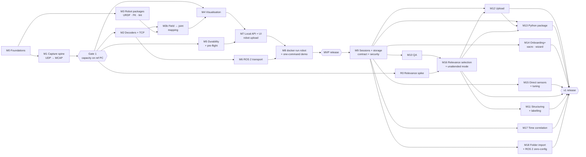

# Kapto: requirements for a robot data-collection application

Status: **DRAFT v0.8**.

**Approach**
- The app **captures data itself** from UDP, TCP and ROS 2 sources, at up to **2 kHz per stream**, and can also **watch a folder** of existing recordings (§4.2, TRN-11).
- **Relevance selection is the core of the product**: the app decides on the edge, per episode, segment and frame, what is kept at full rate, downsampled or discarded before anything is uploaded or deleted (§4.6b).
- The app is **open source under a permissive licence** and has an explicit boundary with any future paid layer (§4.14).
- The reference hardware is a **simple, modest-CPU PC with no discrete GPU** (§6).
- **Rust** for the whole app, plus a **Python package** for end users built on the same crates (§3, §4.10).
- **URDF-based visualisation** in Kapto's own viewer, in the web UI, is core. Robots are added through the UI or at `docker run` (§4.3b).
- **Built-in upload** to S3 or any S3-compatible / blob storage via the `object_store` crate, opt-in and configured by the user (§4.9).
- **Docker** is how the app is built and run. A one-command local demo (§4.11). Publishing images is out of scope for now.
- The detailed timestamp design is **deferred** (§8.1).
- Build order: the **roadmap** in §9.
- **Docs are written with the code** from M0, as plain Markdown in the repo. A published docs site is P3 (§4.13).

## Priorities

| Priority | Meaning | Theme |
|---|---|---|
| **P0** | The app fails without it | Reliable high-rate capture · multi-transport inputs · URDF + visualisation · local storage · Docker build |
| **P1** | Needed for real collection sessions and unattended production capture | **Relevance selection**, episode control, QA, first-pass (automatic) labelling, clock sync, folder import, robot packages from third parties, upload to object storage |
| **P2** | Valuable, after P1 is solid | Enrichment, comparison, extra sensors, export formats, detailed human labelling |
| **P3** | Deferred until explicitly decided | Cloud services: registry/session APIs, device certificates, fleet telemetry, analytics integrations, publishing images and the docs site |

**Hard rule:** the app works fully offline. The **only** data that leaves the
machine is uploads to storage destinations that the **user has configured**.
There is no default destination, no telemetry and no other outbound
connections. All network listeners are inputs from robots or the local
UI/visualiser.

---

## 1. Purpose and scope

One application on the edge (robot PC, operator laptop, or a box next to the
robot) that:

1. **receives** robot data over whatever the robot speaks: UDP, TCP or ROS 2 (others through plugins), or picks up existing recordings dropped into a watched folder;
2. **records it reliably** at up to 2 kHz per stream, with correct timestamps and no silent loss;
3. **shows what is happening**, live and on replay, on the robot's own **URDF** model, in Kapto's own viewer;
4. **decides what is worth keeping**: scores episodes, segments and frames for relevance and keeps, downsamples or discards accordingly, with a record of what was dropped;
5. **structures, checks and first-pass labels** each episode while the context still exists, then writes a self-describing local dataset entry and, if configured, uploads it to the user's own storage.

It works both for **attended collection sessions** (an operator records
demonstrations) and for **unattended production capture** (a deployed robot
records continuously and the app selects what survives, CTL-6).

Different companies' robots must work by providing a **robot package**: URDF
plus meshes, a stream description, and a mapping from fields to joints. No code
changes are needed.

### Non-goals (for now)
- Any dependency on a cloud service to record, view or check data. Upload is an optional last step (§4.9), and cloud services beyond storage are P3.
- Training, and dataset conversion beyond local export formats. Kapto stops at the dataset.
- Cloud-side curation, cross-corpus search and managed conversion. These sit above the collector (§4.14).
- Real-time control. The app is a passive observer and must never sit in a control loop.

---

## 2. Design principles

These come from experience running earlier data-collection tooling in the field.

| Principle | Requirement here |
|---|---|
| A partial recording must never look like a finished one | Record into a hidden staging dir, rename on completion (CAP-9) |
| Consumers need one unambiguous completeness rule | `_FINALISED` + a manifest with checksums locally (STO-3), `_SUCCESS` after verified upload (UPL-4) |
| Raw data is never rewritten | Trims and refinements are plans stored beside it (STO-1, LAB-4) |
| Output fields disappear silently between pipeline hops unless guarded | Versioned, additive-only schemas with contract tests from day 1 (STO-5) |
| Without a robot description, missing data goes unnoticed | The robot package is mandatory. Without one the session is visibly `unchecked` (ROB-2) |
| Checks tied to one robot's topic names don't carry over to the next | Checks use **roles** from the robot package (ROB-3) |
| Thresholds guessed up front are usually wrong | Thresholds per robot package, golden recordings per embodiment, versioned params (QA-4) |
| One generic error message hiding many causes is the most common field failure | Distinct cause code + message + remedy for every failure (NFR-8) |
| A general-purpose viewer left open all day grows without bound | A viewer of Kapto's own, bounded by design, built on three.js and uPlot (§5) |
| Keeping two UIs in parity is a constant tax | One web UI + a CLI (UI-1) |
| Shell glue breaks across platforms | One container or binary, no shell scripts in the product path (NFR-6) |
| Silently changing ports confuses everyone | Explicit ports, validated, reported, never auto-hopped (NFR-7) |
| Automation that rejects data erodes trust | Only deterministic checks can block. Statistical checks flag (QA-1) |
| Comparing an episode with the rest of its session finds what fixed thresholds miss | Session-relative anomalies (QA-5), poolable statistics (STO-7) |
| An unauthenticated API is only safe on loopback | Loopback by default. Authentication before any non-loopback bind (SEC-1) |
| Most recorded data is never used, and what is kept is usually decided by a fixed sampling rate and storage cost | Relevance is decided on the edge, per task, before upload or deletion (REL-1..12) |
| A sampling rate can't be raised, or streams re-aligned, after the fact | Capture at full rate with both timestamps (CAP-3); downsample only as a selection decision (REL-5); record clock state (CAP-4) |
| Unexpected failures fall outside whatever was configured to be logged | Always-on rotating capture with event-triggered keep windows (CAP-13, REL-4) |
| What is relevant depends on the task | Scorers are pluggable and tuned per task in `relevance.toml` (REL-2, REL-3) |
| Discarded data must still be accountable | Every discard leaves statistics and a reason behind (REL-7, STO-7) |

---

## 3. Architecture

The design rests on one principle: **the capture path is isolated and never waits on anything else.**

```
 Robot side                         Kapto
 ──────────                         ─────────────────────────────────────────────────────────
 UDP  (unicast/multicast) ─┐   ┌─ CAPTURE (separate process, real-time priority) ──────────┐
 TCP  (client or server)  ─┼──▶│ transport adapters → decoders → timestamping →           │
 ROS 2 topics (DDS)       ─┤   │ per-stream lock-free ring buffers → MCAP writer          │
 plugins (serial, CAN,    ─┘   │ (chunked, compressed, own thread) → .recording/ → final  │
   shm, OPC UA, …)             │ + loss/jitter accounting per stream                       │
                               └───────┬───────────────────────────┬──────────────────────┘
                                       │ fan-out (lossy, decimated)│ episode / segment closed
                               ┌───────▼────────┐          ┌───────▼─────────┐
                               │ VIS BRIDGE     │          │ PIPELINE        │
                               │ → web viewer   │          │ QA · relevance  │
                               │ URDF + FK      │          │ selection ·     │
                               │                │          │ labels · export │
                               └───────┬────────┘          └───────┬─────────┘
                                       └──────────┬────────────────┘
                                          ┌───────▼────────┐
                                          │ API + Web UI   │ (loopback default)
                                          └────────────────┘
```

- **Capture process** (`capture`): a separate process. It does not depend on the UI, the
  visualiser or the QA. If any of those crash or stall, recording continues.
  Taps for the visualiser are **lossy by design**: they drop or decimate, and
  they never apply backpressure to capture.
- **Pipeline**: works on closed episodes and rotated segments (and optionally
  on live taps for streaming QA and relevance triggers). It never touches the
  raw file except to read it. Relevance selection produces **retention plans**;
  only the retention step (STO-4, REL-6) deletes or replaces raw files, and
  only as the plan says.
- **State**: an embedded transactional store (SQLite WAL) with a single writer
  (the server, §3.1), for runtime state only. User configuration lives in
  files (§4.15).

**Implementation language: Rust**, for the whole application:
capture, decoders, storage, URDF/FK, QA, visualiser bridge, API and CLI.
Several 2 kHz streams per robot, on a modest CPU, with no tolerance for
GC/GIL pauses, need a compiled language without a garbage collector. Rust has
a mature MCAP library, ROS 2 bindings, and good async UDP/TCP.

**Python is the end-user interface, not part of the engine.** A Python package
built from the same Rust crates (PyO3 + maturin) gives users easy access to
the most useful parts: reading recordings, robot packages and FK, checks,
export, and controlling a running collector (§4.10). Python **never runs in
the capture path**.

Suggested Cargo workspace (one repo):

| Crate | Role |
|---|---|
| `kapto-core` | Shared types: streams, samples, episodes, roles, errors with cause codes |
| `kapto-transport` | UDP, TCP, ROS 2 (feature-gated), plugin trait for other transports |
| `kapto-decode` | Declarative decoders (struct layout, Protobuf, FlatBuffers, CDR, JSON/MsgPack) |
| `kapto-capture` | Ring buffers, timestamping, loss accounting, MCAP writer, finalisation |
| `kapto-robot` | Robot packages: URDF/xacro loading, meshes, mapping, linter, FK |
| `kapto-qa` | Streaming and post-episode checks |
| `kapto-select` | Relevance scorers, keep-window triggers, retention plans, discard audit |
| `kapto-viz` | Viewer bridge and replay views: decimation, scenes, layouts |
| `kapto-store` | SQLite runtime state, `episode.json`, manifest, schema versions, exporters |
| `kapto-config` | TOML config: schemas, loading, precedence and source tracking, comment-preserving writes, per-episode snapshots, history (§4.15) |
| `kapto-upload` | `Destination` trait, the generic upload engine (queue, retries, verification, completeness marker) and the `object_store` implementation (§4.9). Separate from `kapto-store` because it pulls in tokio and HTTP |
| `kapto-server` | Daemon and process supervisor, local REST/WebSocket API, web UI assets |
| `kapto-cli` | `kapto` binary: CLI commands and the `capture`, `viz-bridge` and `worker` subcommands |
| `kapto-py` | Python bindings (PyO3), published as the **`kapto`** wheel (`import kapto`) |
| `kapto-wasm` | Rust compiled to WebAssembly for the web UI: logic that must behave exactly as on the server (config validation, role and path-template rules, lint rendering) |
| `tools/kapto-loadgen` | Synthetic robot: UDP/TCP/ROS 2 streams and a camera, for the demo, tests and benchmarks |
| `tools/xtask` | Developer automation in Rust (`cargo xtask ci, gen, bench, profile, golden`), instead of shell scripts or Makefiles |

### 3.1 Process and thread model

Kapto runs as **four long-lived processes started from the same `kapto`
binary**, plus short-lived plugin subprocesses. Separate processes give crash
isolation; inside each process the concurrency model follows the work:
**dedicated threads for high-rate, latency-sensitive work; async (tokio) only
for many mostly-idle I/O connections** (HTTP clients, WebSockets, uploads).

```
kapto-server ─────────── tokio (2 worker threads by default)
│  supervisor · REST/WS API · web UI · SQLite (only writer) · config writes
│  triggers: HID pedal, ROS 2 service/topic, UDP/TCP command messages
│
├── capture ──────────── plain threads, normal or real-time priority (CAP-12)
│     receiver thread per UDP socket group · thread per TCP connection
│     ROS 2 executor thread · thread per direct camera · audio thread
│     MCAP writer thread · stats/tap thread
│
├── viz-bridge ───────── plain threads, slightly lowered priority
│     tap reader thread · WebSocket to each page
│
└── worker ───────────── low priority (nice 10, low I/O priority)
      job scheduler thread · CPU pool (default 1 thread, configurable)
      streaming consumer thread (reads the tap) · tokio runtime (1 thread) for uploads
      └── plugin subprocesses (Python checks/scorers/labellers), time-limited
```

| Process | Does | Concurrency | Must never |
|---|---|---|---|
| `kapto-server` | Supervises the others; API and UI; **only writer of SQLite**; owns the job queue; writes config files; hosts triggers that arrive as commands (HID, ROS 2 service, UDP/TCP command) | tokio, small runtime | Be on the data path. Capture works without it |
| `capture` | Receives, timestamps, decodes live fields, evaluates **stream-field triggers** (they must see every message), writes MCAP, finalises episodes, rotates segments, emits the lossy tap | One thread per input source (UDP socket group, TCP connection, ROS 2 executor, camera, audio); one writer thread; one stats/tap thread. Sources hand batches to the writer through lock-free single-producer queues | Wait on any other process, allocate or log per message, use async |
| `viz-bridge` | Turns the tap into the live view's frames (FK at display rate, decimated plots, health) | Plain threads | Apply backpressure to capture |
| `worker` | All heavy or slow work: post-episode QA, statistics, relevance scoring and retention, automatic labelling, exports, upload; streaming checks and keep-window triggers from the tap | Scheduler thread pulls jobs from the server; bounded CPU pool for CPU-bound jobs; one streaming-consumer thread; a one-thread tokio runtime for uploads | Run heavy jobs while recording (EFF-5, configurable); run Python in-process |
| plugin subprocess | One Python check, scorer or labeller run | One process per run, killed at its time limit | Touch the capture path |

**Communication**

| Path | Mechanism | Properties |
|---|---|---|
| Control (server ↔ each child) | Unix stream socket, length-prefixed `postcard` messages, versioned enums in `kapto-core` | Request/response plus events. Rare messages, never per sample |
| Live data (capture → viz-bridge, capture → worker) | Non-blocking Unix datagram socket | Lossy by design: full = drop and count (VIS-6, EFF-4) |
| State updates (capture, worker → server → SQLite) | Events over the control socket | The server is the only SQLite writer. If it is down, capture keeps recording and the server rebuilds its index from `/data` on restart (CFG-2); the worker pauses |
| Recordings | Files under `/data` | Capture writes; others read. Only the worker's retention executor and upload read-modify them, as plans and verification allow (REL-6, UPL-7) |

**Lifecycle rules**
- The server restarts `viz-bridge` and `worker` after a crash. It never
  restarts `capture` while it is recording.
- If the server dies, `capture` keeps recording, finalises the current
  episode after a configurable control timeout, and waits for the server to
  return. Nothing is lost.
- Every thread has a name (`cap-rx-udp-0`, `cap-writer`, `wrk-cpu-1`, …),
  so OS tools and the profiler (§6.1) attribute time correctly.

---

## 4. Functional requirements

### 4.1 Capture: rate, reliability, time (CAP), P0
| ID | Pri | Requirement |
|---|---|---|
| CAP-1 | P0 | Sustain **2 kHz per stream** on at least **16 concurrent high-rate streams**, plus cameras (see §6 budget), with **zero application-level drops** over a 1 h session on the reference hardware |
| CAP-2 | P0 | **Loss is always accounted for, never silent.** Per stream: received, decoded, written, dropped-by-us, and lost-upstream (from sequence-number gaps when the source provides them; inferred from rate gaps otherwise). Recorded in the episode and shown live |
| CAP-3 | P0 | Every sample stores a **receive timestamp** (monotonic clock at read, plus a monotonic → UTC mapping per episode), and the **source timestamp** as-is when the payload has one. The storage format leaves room for the deferred timestamp design (§8.1) without a format change |
| CAP-4 | P1 | **Cross-stream time correlation** (§8.1): record the host clock-sync state (NTP/PTP) per episode, estimate source-clock offset and drift per stream when source timestamps exist, and store the estimates beside the raw data (never overwriting either timestamp), so co-mounted sensors can be fused into one episode. Kernel receive timestamps stay deferred (§8.1) |
| CAP-5 | P0 | A per-stream ring buffer sized from the declared rate and the configured max writer stall (default ≥ 2 s). Overflow increments `dropped_by_us` and raises a live alarm |
| CAP-6 | P0 | The MCAP writer runs on its own thread or process: chunked, compressed (zstd/lz4, configurable), with batched writes. A configurable fsync policy bounds data loss on power cut (default: ≤ 1 s) |
| CAP-7 | P0 | A **pre-roll buffer** (configurable, e.g. 5 s) so data from just before "start" is kept, plus a **post-roll / tail** per stream (e.g. audio for spoken review) |
| CAP-8 | P0 | Crash and power-loss safety: a recording interrupted at any point is recoverable to its last complete chunk, and is marked `recovered` rather than looking complete |
| CAP-9 | P0 | Atomic finalisation: write into `<out>/.recording/<episode>/`, then rename to `<out>/<episode>/` and write `_FINALISED` last |
| CAP-10 | P0 | Pre-flight before a session: disk free and sustained write speed against the expected data rate, every declared stream seen at roughly its declared rate, clock state. The session refuses to start, or starts with a recorded waiver |
| CAP-11 | P0 | Disk-pressure handling: warn at a configurable threshold, then **stop the episode cleanly** before the disk is full. Never leave a corrupt file |
| CAP-12 | P1 | Optional CPU pinning and real-time priority for capture threads. Documented tuning for Linux (socket buffer sizes, `rmem_max`) and a check that warns when they are too small. **Not required** to meet the PERF targets on the reference PC |
| CAP-13 | P1 | **Continuous mode** (always recording into rotating segments) in addition to start/stop episodes, with episodes cut from the segments afterwards. This is the capture side of unattended production use (CTL-6) and the input to relevance selection (§4.6b): segments are held in a bounded local buffer until selection has decided what to keep from them |

### 4.1b CPU efficiency on a modest PC (EFF), P0
| ID | Pri | Requirement |
|---|---|---|
| EFF-1 | P0 | **No transcoding or re-encoding in the capture path.** Camera frames are stored exactly as received (MJPEG/H.264/compressed image). Raw camera input, if supported at all, is encoded by a plugin outside the `capture` process, with a documented CPU cost |
| EFF-2 | P0 | **Batching throughout**: batched socket reads, decode in batches, write MCAP in chunks. No per-message thread hand-off, allocation or syscall on the hot path |
| EFF-3 | P0 | Compression is cheap by default (lz4 or low-level zstd) and configurable. On the reference PC, compression must never be what limits capture |
| EFF-4 | P0 | Visualiser cost is capped and independent of input rate: the live tap is decimated (VIS-2), the 3D model updates at ≤ 30–60 Hz, camera frames go to the viewer at up to a maximum rate (`viewer.camera_max_fps`, 30 fps by default), each camera's newest frame each time, while every frame is recorded |
| EFF-5 | P0 | Heavy work (post-episode QA, statistics, previews, exports, transcription) runs **after** capture at low OS priority, pauses while an episode is recording (configurable), and is resumable. Nothing heavy runs concurrently with capture by default |
| EFF-6 | P0 | No GPU required for anything in P0–P1. The viewer needs only the integrated graphics a normal PC has. GPU-only features (transcription, ML) are optional plugins |
| EFF-7 | P1 | A **low-power profile** (e.g. viewer camera rate 5 fps, plots at 50 Hz, post-episode QA deferred to session end) selectable when the PC is weaker than the reference |
| EFF-8 | P0 | CPU and memory usage per component (capture, decode, writer, viewer bridge, UI) shown live, and kept as a history in Kapto's runtime state so the use during any episode can be looked up, so a slow PC is diagnosed from data. Never written into the episode itself: a recording holds only what the robot sent and how it was received |

### 4.2 Transports and decoding (TRN), P0
Different robots work in different ways, so the input layer is a **plugin
interface** with these built in:

| ID | Pri | Requirement |
|---|---|---|
| TRN-1 | P0 | **UDP**: unicast and multicast, IPv4 and IPv6, several ports or groups at once, large socket buffers, batched receive (`recvmmsg`) to keep CPU low at 2 kHz × many streams, an optional per-source allow-list |
| TRN-2 | P0 | **TCP**: client mode (connect to the robot) and server mode (robot connects to us), auto-reconnect with backoff, and explicit framing: length-prefixed (configurable header), delimiter-based, or fixed-size. Reconnects are recorded as gaps in the stream |
| TRN-3 | P0 | **ROS 2**: subscribe to topics with configurable QoS, any message type (dynamic typing from installed interfaces or embedded schemas), stored as CDR with its schema in MCAP. Also `/tf` and `/tf_static` |
| TRN-4 | P0 | **Declarative decoders** for UDP/TCP payloads, defined in the robot package with no code: <br>• binary struct layouts (field name, type, endianness, offset, array length, scale) <br>• Protobuf <br>• FlatBuffers <br>• CDR <br>• JSON / MessagePack <br>Each decoded field gets a name and a unit |
| TRN-5 | P0 | **Decoder test kit**: replay a captured packet dump (pcap) through a decoder and show the decoded values, so a robot integrator can validate a package offline |
| TRN-6 | P0 | **Raw passthrough**: if a payload cannot be decoded, store the raw bytes with timestamps anyway (flagged as undecoded), so nothing is lost while the decoder is being fixed |
| TRN-7 | P1 | Cameras: through ROS 2 (image/compressed image) **and** directly through V4L2/UVC and common SDKs (RealSense; GigE Vision as a plugin), storing encoded frames (MJPEG/H.264) with frame timestamps |
| TRN-8 | P1 | Audio: an ALSA/PulseAudio input stored as an audio stream (for narration and spoken review) |
| TRN-9 | P2 | Further plugins: serial/RS-485, CAN/CAN-FD (SocketCAN + DBC), shared memory, WebSocket, gRPC streams, OPC UA (subscriptions), ROS 1 (through a bridge) |
| TRN-10 | P1 | **Output commands are out of scope.** The app only listens. Any transport configured to send (e.g. a TCP handshake or a subscribe request) must be declared explicitly in the robot package |
| TRN-11 | P1 | **Watched folder import**: watch a configured folder (or import a path from the CLI/UI) and ingest recordings written by other tools: **MCAP** and **ROS 2 bags** first. Each file becomes an episode (or segments) that goes through the same mapping, visualisation, QA, relevance selection and upload as live capture. Files are read in place and never modified; a file is picked up only once it is complete (stable size / closed handle) |
| TRN-12 | P2 | Further import formats for TRN-11: ROS 1 bags, **PX4 ULog**, Rerun `.rrd`, LeRobot datasets |
| TRN-13 | P1 | **ROS 2 zero-config mode**: with no stream description, discover and record every topic seen (with an optional include/exclude filter), so a team can start recording before writing a robot package. The session is marked `unchecked` (ROB-2) until a package is attached |

### 4.3 Robot packages: URDF, streams, roles (ROB), P0
A **robot package** is a versioned folder (or archive) that a robot vendor or
integrator provides. Kapto's own files in it are TOML (ROB-12); URDF, xacro
and meshes stay in their native formats:

```
robot-package/
├── package.toml        # id, vendor, model, version, embodiment class, contact
├── urdf/robot.urdf     # or robot.urdf.xacro (+ args)
├── meshes/…            # STL / DAE / OBJ / glTF, resolved from package:// URIs
├── streams.toml        # transports, endpoints, decoders, rates, units
├── mapping.toml        # decoded field → URDF joint / frame / role
├── qa.toml             # thresholds and check selection for this robot
├── relevance.toml      # default relevance scorers, triggers and retention tiers (§4.6b; tasks can override)
└── layout.toml         # the view's layout for this robot (optional, generated if absent)
```

| ID | Pri | Requirement |
|---|---|---|
| ROB-1 | P0 | Load URDF. Resolve `package://` and relative mesh paths inside the package. Support STL, DAE, OBJ and glTF meshes, plus visual and collision geometry. xacro input is expanded to URDF first (ROB-11) |
| ROB-2 | P0 | A session requires a robot package. Without one, recording still works (raw passthrough), but the session is labelled `unchecked` everywhere |
| ROB-3 | P0 | **Mapping**: decoded fields → URDF joints (position, and optionally velocity/effort), → frames (EE pose measured/commanded, base pose), → roles (`arm.left.joints`, `gripper.left`, `camera.head.rgb`, `wrench.left`, `base.odom`, `hitl.flag`, …). Joint names are validated against the URDF at load time |
| ROB-4 | P0 | **Package linter**: URDF parse, missing meshes, unmapped joints, mapped fields that don't exist in decoders, unit mismatches, joint limits present, camera frames present. Run from the CLI and on import |
| ROB-5 | P0 | **Forward kinematics** in the app from URDF + joint states, giving link transforms for visualisation and derived signals (EE pose when the robot doesn't publish it, workspace, self-distance) |
| ROB-6 | P0 | **Sensor frames**: camera intrinsics and extrinsics are attached to URDF links, so the visualiser draws camera frustums and can project into images. Both fixed-mounted and arm-mounted cameras are supported |
| ROB-7 | P1 | Several robots or parts in one scene (two arms from different vendors, an arm on a mobile base), each from its own package, composed by a scene file with mount transforms |
| ROB-8 | P1 | Package versioning: every episode records the package id, version and content hash, and embeds the package (or its hash plus a local copy) so an episode can be replayed with exactly the model it was recorded with |
| ROB-9 | P1 | Embodiment classes supported: single arm, bimanual, mobile base, mobile manipulator, handheld/UMI, simulation |
| ROB-10 | P2 | Scaffold a package from a sample capture: list the streams seen, propose decoders, match field names to URDF joint names |
| ROB-11 | P1 | **xacro support** (see §5.1). <br>• **ROS 2 image:** expand with the real `xacro` tool, in a sandboxed subprocess with a timeout and no network. `$(find pkg)` resolves to installed packages and to packages under `/packages` <br>• **Non-ROS image:** a built-in Rust expander for the common subset: properties, args, macros, math expressions, conditionals, includes, and `$(find pkg)` resolved within the uploaded archive or `/packages`. Anything outside the subset produces a lint error that suggests pre-expanding the file <br>• **Both:** the **expanded URDF is stored in the package**, so episodes, replay and QA never depend on xacro again |
| ROB-12 | P0 / P1 | **TOML for package files, ROS YAML as import only.** `package.toml`, `streams.toml`, `mapping.toml`, `qa.toml` and `relevance.toml` are TOML, each with a JSON Schema (DOC-3). The UI and CLI edit them with `toml_edit`, keeping comments, formatting and key order (ADD-5, ADD-8). Existing ROS YAML that carries useful data (e.g. `ros2_control` joint limits and controller configs, `joint_names` lists, camera calibration YAML) is accepted at import (ADD-1, ADD-10, ADD-15) and converted into the TOML files, with the source file and hash recorded. The converted TOML, not the YAML, is the source of truth afterwards, the same rule as for xacro (ROB-11). The TOML format is P0; importing ROS YAML is P1 |

### 4.3b Adding a robot: through the UI or at `docker run` (ADD), P0
Adding a robot must be **easy for someone who has a URDF and nothing else**.
The full robot package (§4.3) is where they end up, but they must never have
to write it by hand to get started. There are two equal entry points, and both
produce the same package on the `/packages` volume.

**Entry point A: the UI**
| ID | Pri | Requirement |
|---|---|---|
| ADD-1 | P0 | **Upload** in the UI, by drag-and-drop or file picker: <br>• a single `.urdf` <br>• a `.urdf.xacro` (with an args form) <br>• a `.zip`/`.tar.gz` of a ROS `*_description` package <br>• a full robot package <br>Meshes come inside the archive, or are uploaded afterwards when the linter lists them as missing |
| ADD-2 | P0 | **Instant 3D preview** in the web UI's viewer right after upload, with **joint sliders** to move each joint within its URDF limits. The user sees immediately whether the model, meshes, scale and axes are right |
| ADD-3 | P0 | **Lint results inline**: <br>• each problem says where it is and how to fix it <br>• missing meshes appear as upload slots <br>• `package://` URIs that can't be resolved are shown with the path searched <br>• problems are split into warnings (save allowed) and errors (save refused) |
| ADD-4 | P0 | **Auto-map by name**: when the incoming stream fields have the same names as the URDF joints (the common case for ROS `JointState`), the mapping is created automatically and shown for confirmation |
| ADD-5 | P1 | **Mapping wizard** for the rest: <br>• pick a source (UDP port / TCP endpoint / ROS topic) <br>• see the live decoded fields <br>• assign fields to joints, roles and units by dropdown <br>• get **live feedback**: the preview model moves with the real or simulated stream as soon as a joint is mapped <br>• unmapped joints are highlighted on the model |
| ADD-6 | P1 | Camera and sensor frames: pick the URDF link a camera is mounted on, enter or upload intrinsics, and see the frustum in the preview |
| ADD-7 | P0 | **Save** writes a normal robot package to `/packages/<robot-id>/` (version 1, content hash), visible immediately in session setup. **Download** exports it as an archive, to commit to a robot-packages repo or give to another collector |
| ADD-8 | P1 | Edit and version: re-uploading a URDF or changing the mapping creates a new package version. Episodes keep pointing at the version they were recorded with (ROB-8) |

**Entry point B: `docker run` / compose**
| ID | Pri | Requirement |
|---|---|---|
| ADD-9 | P0 | **Mount a bare URDF and go:** <br>`docker run -v ./my_robot:/robot:ro -e KAPTO_URDF=/robot/robot.urdf …` <br>The container builds a package from it at startup (meshes resolved relative to the URDF, or from `KAPTO_MESH_PATH`), auto-maps by name (ADD-4), and makes it the active robot. No other files needed |
| ADD-10 | P0 | **Mount a ROS description package or a full robot package:** <br>`-v ./my_robot_description:/packages/my_robot:ro` <br>Every folder under `/packages` is discovered at startup. `KAPTO_ROBOT=my_robot` selects the active one, and the UI offers the rest |
| ADD-11 | P1 | xacro via env: `KAPTO_URDF=/robot/robot.urdf.xacro` plus `KAPTO_XACRO_ARGS="arm:=left gripper:=true"`, expanded per ROB-11 |
| ADD-12 | P0 | **Fail loudly at startup**: if the mounted URDF does not lint, the container logs the same lint report as the UI and keeps running with the robot marked `invalid`, instead of crash-looping. The UI shows the report and an upload slot for fixes |
| ADD-13 | P1 | **Hot reload**: a change to a mounted package (files edited on the host) is picked up without restarting the container. It becomes a new package version, and never changes a session that is already recording |
| ADD-14 | P1 | Read-only mounts work. Packages built from a read-only mount (ADD-9) are written to the data volume, never back into the mount |
| ADD-15 | P0 | CLI equivalents for scripting and CI: `kapto package import <urdf|dir|archive>`, `package lint`, `package preview` (opens the viewer). `docker run --rm kapto package lint /packages/x` is the lint gate for robot-package repos |

**Constraints on both entry points**
| ID | Pri | Requirement |
|---|---|---|
| ADD-16 | P0 | **Safe parsing of uploaded files:** <br>• archive extraction is protected against path traversal ("zip slip") <br>• size limits on uploads, files and mesh triangle counts (configurable) <br>• no symlinks followed out of the package <br>• xacro is never expanded in-process with arbitrary code execution: the built-in expander evaluates a restricted expression language, and the real `xacro` tool runs only in a sandboxed subprocess (ROB-11) |
| ADD-17 | P0 | **Large meshes stay usable on a modest PC:** the viewer gets a decimated display mesh automatically when a mesh exceeds a triangle budget. The original is kept for collision-based checks |
| ADD-18 | P0 | Units and axes: detect common mistakes (meshes in mm instead of m, Y-up vs Z-up) and show a warning with a one-click fix in the preview |
| ADD-19 | P1 | Built-in sample packages (DCK-2) are listed as templates: "start from generic 7-DOF arm" |

### 4.4 Visualisation: the robot's URDF in Kapto's viewer (VIS), P0
| ID | Pri | Requirement |
|---|---|---|
| VIS-1 | P0 | **Live 3D view** of the robot's URDF model driven by the incoming joint states (via FK), with camera frustums and images, EE frames (measured vs commanded, both shown), and base pose |
| VIS-2 | P0 | **Live plots** of high-rate signals. The visualiser tap **decimates** for display (e.g. to 100–200 Hz, min/max preserving so spikes stay visible) and never slows capture. Full rate stays available on replay |
| VIS-3 | P0 | **Replay** of any recorded episode with the same layout, full-rate scalars, synced cameras and a scrub-able timeline. Both source-time and receive-time timelines available |
| VIS-4 | P0 | **Capture health in the view**: per-stream rate, jitter, drops and lost-upstream as live plots and alarms, so the operator sees a problem while it happens, not after the episode |
| VIS-5 | P0 | **Layout per robot package**, with a default generated from roles when the package provides none |
| VIS-6 | P0 | The viewer is a separate process. A viewer crash or stall has no effect on capture (verified by test). The viewer is part of the app's web UI |
| VIS-7 | P1 | **QA overlay**: check results, anomalies, joint-limit violations, jumps and drops shown as markers on the timeline and highlighted on the 3D model (e.g. a link coloured when its joint is near a limit) |
| VIS-8 | P1 | Labelling from the viewer: select a time range in the timeline and turn it into a subtask segment, trim or flag through the app API |
| VIS-9 | P2 | Compare: two episodes side by side or ghost-overlaid on the same URDF. Overlay against the session's median trajectory |
| VIS-10 | P2 | Point clouds, depth, wrench arrows at the contact frame, and the gripper state rendered on the model |
| VIS-11 | P1 | **Your own layout**: the operator chooses which cameras, plots (any decoded field) and health panels the live view shows and arranges them in the web UI, without editing files. Each browser keeps the layout it was left with; one can be saved as the default every browser starts from, kept as a file with the rest of the configuration; the package's layout (VIS-5) is always one click away |

### 4.5 Episode and session control (CTL), P1
| ID | Pri | Requirement |
|---|---|---|
| CTL-1 | P0 | Start/stop/abort an episode from the UI, CLI and local API |
| CTL-2 | P1 | Start/stop from robot-side triggers: a ROS 2 service/topic, a UDP/TCP command message, a field in a stream (e.g. a clutch or pedal bit), a keyboard or foot pedal (HID) |
| CTL-3 | P1 | Subtask marks during recording (from a trigger or the UI), with the prompt/task chosen from the session vocabulary |
| CTL-4 | P1 | Session setup: robot package, operator, task, prompts and objects, environment, notes, tags. Validated (no blank or `na`) and frozen into every episode. Saved setups are session profiles in `/config/profiles/` (CFG-1). In unattended mode (CTL-6) the operator and prompt fields come from the profile instead of a person |
| CTL-5 | P1 | An HITL/intervention flag stream (by role), with episodes containing an intervention tagged automatically |
| CTL-6 | P1 | **Unattended production mode**: a saved session profile starts at boot and records continuously (CAP-13) with no operator. Episodes are cut by triggers (CTL-2) and relevance selection (§4.6b), not by a person pressing start. No step in this mode waits on human review; review (LAB) is optional and can happen later or never |
| CTL-7 | P1 | **Mode of operation per episode**: teleoperated, autonomous (policy rollout), mixed (with HITL, CTL-5), or scripted. Recorded in `episode.json` so autonomous rollouts and their failures are kept and findable, not filtered out as bad demonstrations |
| CTL-8 | P1 | **Your own metadata per episode**: keys the user defines for their use case (e.g. site, payload, fixture, experiment), given in the robot package or session profile, or at start from the UI, CLI (`--meta key=value`) and API. The package may declare which keys exist, their types and which are required; a start missing a required one is refused with a cause code. Written into the MCAP as a metadata record and into `episode.json`, and shown in the API and UI. Time-stamped notes during an episode are subtask marks (CTL-3) or labels, not this |

### 4.6 Quality assurance (QA), P1
| ID | Pri | Requirement |
|---|---|---|
| QA-1 | P1 | Two classes: **gates** (deterministic and structural; they can block "accept") and **advisories** (statistical; they only flag) |
| QA-2 | P1 | **Streaming checks** during capture: rate drop, gaps, frozen stream, sequence loss, clock skew, all visible in VIS-4. **Post-episode checks**, run against roles: <br>• monotonic time, dropped frames, black/corrupt frames <br>• duration and size bounds, segment coverage <br>• EE-pose and commanded-pose jumps, quaternion validity <br>• inter-camera sync, teleop lag, action/observation alignment <br>• smoothness (arms only), gripper chatter, static ratio, saturation <br>• video sharpness, exposure and motion |
| QA-3 | P1 | **URDF-aware checks**: joint position, velocity and effort limits from the URDF; self-collision proximity (from collision geometry); workspace bounds; FK-vs-reported EE pose consistency (catches wrong mapping or calibration) |
| QA-4 | P1 | Thresholds live in the robot package's `qa.toml`. `qa_params_version` is recorded. Golden recordings per embodiment with regression tests |
| QA-5 | P1 | Session-relative anomalies (median + MAD across the session's episodes, or across recent segments in continuous mode), advisory only. Also an input to relevance scoring (REL-3) |
| QA-6 | P2 | **Drift across sessions**: compare per-stream statistics (STO-7) against a rolling baseline per machine to flag slow degradation (dust, lighting, mechanical wear, sensor ageing) that no single session shows. Advisory only |

### 4.6b Relevance selection (REL), P1
Most recorded robot data is never used for training, and what is kept is
usually decided by a fixed sampling rate and storage cost. Kapto decides on
the edge, per task, what to keep, and records that decision, before anything
is uploaded or deleted.

**Selection is not rejection (QA-1 still holds).** QA advisories never
reject an episode. Relevance discards only what a **retention policy the
user configured** says to, after a dry-run is available (REL-6), with an
audit and statistics left behind (REL-7), and with human overrides winning
(REL-8). QA flags and anomalies only ever *raise* a range's score, so a
suspicious range is kept, never dropped for being suspicious. With no
relevance config, everything is kept at full rate.

Selection never touches the capture path. It runs on closed episodes and
rotated segments (and on decimated live taps for triggers), produces
**retention plans**, and only the retention step acts on them.

| ID | Pri | Requirement |
|---|---|---|
| REL-1 | P1 | **Scores at three granularities**: episode, segment (time range) and frame/sample range. Every score has a value, the scorer that produced it, the scorer version and params, and a short human-readable reason. Scores are stored beside the raw data and in `episode.json`, never inside the MCAP |
| REL-2 | P1 | **Pluggable scorers** behind one trait (Rust) and the same decorator API as Python checks (PY-6), run post-segment in a separate worker with a time limit. Built-in scorers to start with: <br>• QA results and anomalies (QA-2, QA-3, QA-5) <br>• novelty against the recent history of this machine and task (STO-7 statistics) <br>• activity / static-ratio (idle time scores low) <br>• events: interventions (CTL-5), failures, subtask boundaries, contact/wrench peaks, gripper events <br>• mode (CTL-7): autonomous failures and recoveries score high |
| REL-3 | P1 | **Tuned per task, not generic**: `relevance.toml` in the robot package gives defaults, and a task (`/config/tasks/`, CFG-1) referenced by the session profile can override scorer selection, weights and thresholds, following the precedence in CFG-3. `relevance_params_version` is recorded per episode. A team can replace all built-in scorers with its own |
| REL-4 | P1 | **Keep windows from triggers**: streaming detectors (QA-2), robot-side triggers (CTL-2), interventions (CTL-5) and manual marks open a keep window with configurable pre/post time around the event, at full rate. In continuous mode this works on the segment buffer (CAP-13), so the seconds *before* an unexpected event are kept even though nobody pressed record |
| REL-5 | P1 | **Retention tiers** per stream and per segment: `keep` (full rate, as recorded), `downsample` (to a configured rate, min/max-preserving for scalars, reduced fps for cameras without re-encoding where possible), `summary` (statistics only, STO-7), `discard`. The mapping from score to tier is part of the task config |
| REL-6 | P1 | **Selection is a plan, retention acts on it**: the plan is written beside the raw data; the raw files are only deleted or replaced by the retention step, after the plan is final and, if upload is on, after the kept part is verified on its destinations (UPL-7). Until then any plan can be changed and re-applied. A `dry-run` mode reports what a plan would keep and discard, with sizes |
| REL-7 | P1 | **Discard audit**: everything not kept at full rate leaves a record behind: time range, streams, tier applied, scores and reasons, and the per-stream statistics of the discarded data (STO-7). Totals per session (recorded vs kept vs downsampled vs discarded, in time and bytes) are shown in the UI and written to `episode.json` |
| REL-8 | P1 | **Human override**: an operator or reviewer can pin any range to `keep` or `discard` from the UI or the viewer timeline (VIS-8). Overrides are recorded with who and when (LAB-2), and win over scorers |
| REL-9 | P1 | **Visible in the viewer**: relevance scores as a timeline track and keep windows as markers, next to QA (VIS-7), so a user can see why a range was kept or dropped |
| REL-10 | P1 | **Evaluation harness**: replay a labelled set of recordings (golden recordings, or a team's own) through a relevance config and report precision/recall of kept ranges against the labels, plus the data reduction achieved. This is how a config is tuned for a task and how we test whether one config carries over to another task or embodiment |
| REL-11 | P1 | **Budget-aware**: an optional storage or upload budget per day/session; when it would be exceeded, the lowest-scoring ranges move down a tier first, never the highest-scoring ones. The budget state is shown live |
| REL-12 | P2 | Learned scorers (e.g. embedding novelty, small on-CPU models) as optional plugins, respecting EFF-6 (no GPU required for P0–P1) |

### 4.7 Structuring, labelling and review (LAB), P1
The bottleneck is **structuring** episodes, not annotating them. So the P1
weight is on labels produced automatically at recording time; detailed human
review is useful but secondary, and is never required for data to flow
(CTL-6, UPL-3).

| ID | Pri | Requirement |
|---|---|---|
| LAB-6 | P1 | **Automatic first-pass labels at recording time**, all marked `source: algo` and correctable: <br>• subtask segmentation from triggers, gripper events, contact/wrench events and idle periods <br>• mode (CTL-7) and intervention ranges (CTL-5) <br>• outcome hints (success/fail/unknown) from robot-side signals when the package maps them <br>• tags from QA and relevance (REL-1) <br>Rules come from the robot package and task config; Python plugins can add labellers (PY-6) |
| LAB-1 | P1 | Accept/reject in one action, notes, tags, and a controlled vocabulary. Optional: when review is off, episodes are `unreviewed` and still flow on to selection and upload |
| LAB-2 | P1 | Corrections keep the original value and record who changed it and when. Flags, labels and relevance overrides carry who raised them (`operator | algo | validator`) and survive acceptance |
| LAB-3 | P2 | Success/fail/partial **per subtask** set by a person, as well as per episode |
| LAB-7 | P2 | A review queue ordered by relevance score and QA flags, so the few ranges worth a human look come first |
| LAB-4 | P2 | Trim and refinement as **plans** beside the raw data, applied only on export |
| LAB-5 | P2 | Voice narration and spoken review (local transcription only, optional GPU) |

### 4.8 Local storage and export (STO), P0/P1
| ID | Pri | Requirement |
|---|---|---|
| STO-1 | P0 | Raw recordings are immutable MCAP: one file per episode (or rotated segments), channels per stream, schemas embedded, source and receive timestamps preserved. **Payloads are stored exactly as received.** Self-describing encodings get the matching MCAP schema encoding (`ros2msg` for CDR, `protobuf`, `flatbuffer`, `jsonschema`), so third-party tools read them directly. Binary struct layouts are stored raw with a `kapto.struct/v1` schema (the layout from `streams.toml`) and decoded by Kapto's readers, exporters and Python package. Capture decodes only the fields it needs live (sequence number, source timestamp, mapped joints) |
| STO-2 | P0 | Per-episode sidecar `episode.json` (flat): session values, package id/version/hash, per-stream statistics (count, rate, jitter p50/p99, drops, lost-upstream, gaps), QA results, labels, app version and config hash. From P1 also: hashes of the config snapshot, profile and task (CFG-6), relevance scores, retention plan and discard totals (REL-1, REL-7), mode (CTL-7), clock state (CAP-4) and machine provenance (STO-8) |
| STO-3 | P0 | `_FINALISED` + `manifest.json` (every file with sha256 and size) as the single completeness rule for anything reading the output folder |
| STO-4 | P1 | Output to a local disk or a user-chosen LAN/NAS mount, with an explicit copy/verify step to a second location (local disk/NAS, or object storage per §4.9) and a retention policy that never deletes before a verified copy exists. Retention applies relevance plans (REL-6): only ranges a final plan marks `downsample`, `summary` or `discard` are reduced or removed. An optional **minimum retention period** per tier (e.g. one year for ranges flagged safety-related) can be configured |
| STO-5 | P1 | Versioned, additive-only schemas for `episode.json` and the manifest, with a schema-lock test |
| STO-6 | P2 | Exporters, run locally: LeRobot dataset, HDF5, Rerun `.rrd`, CSV/Parquet for scalars, with optional resampling to a common rate. These are the basic, open-source exporters (§4.14) |
| STO-7 | P1 | Poolable per-stream statistics (moments, sketches, fixed histograms) per episode and per segment, for dataset-level summaries without reopening recordings. They are the input to novelty scoring (REL-2) and drift (QA-6), and they are what remains of discarded data (REL-7) |
| STO-8 | P1 | **Machine provenance** in every episode, so that "what ran" can be tied to "what happened" on one machine: machine id/serial, software and firmware versions, policy/model identity and weights hash (when a policy runs, CTL-7), calibration id/hash, and the robot package version (ROB-8). Values come from the session profile, robot-side fields mapped by role (e.g. `meta.policy.hash`), or files in a configured provenance folder. Missing values are recorded as missing, never guessed. This is the data a later per-machine behaviour record (CLD-8) is built from, without a parallel pipeline |

### 4.9 Upload to object storage (UPL), P1
A built-in, opt-in way to move accepted episodes to **S3 or any S3-compatible
or blob storage**. It is built on an existing, well-maintained Rust crate, not
our own HTTP client.

**Crate: `object_store`** (Apache Arrow project). It is used in
production by DataFusion, delta-rs and others. It covers AWS S3 and
S3-compatible services (RustFS, MinIO, Ceph RGW, Cloudflare R2, Wasabi, Backblaze B2,
SeaweedFS…), Google Cloud Storage, Azure Blob Storage and the local
filesystem, with multipart upload and the standard credential sources.

**Built for more destinations than one library.** The upload code is a
generic **engine** (queue, scheduling, retries, bandwidth, verification,
completeness marker, retention gating) over a small **`Destination` trait**
of ours. Each destination declares its capabilities (resumable uploads,
server-side checksums, conditional writes) and the engine adapts to them.
`object_store` is one implementation; an in-memory one is used in tests.
Future destinations such as SFTP/FTP or Google Drive are new implementations
of the trait, with no change to the engine, the queue or the config format
(destinations are tagged by `kind`).

| ID | Pri | Requirement |
|---|---|---|
| UPL-1 | P1 | **Off by default.** No destination is preconfigured. The user adds one or more destinations in the UI or `kapto.toml` (the UI writes to the file, CFG-4), or env vars: provider, bucket/container, prefix, region, and endpoint URL (for S3-compatible services) |
| UPL-2 | P1 | **Credentials from standard sources**, never stored in recordings or logs: <br>• env vars <br>• AWS-style shared config/credentials files mounted into the container <br>• instance/workload roles where the provider supports them <br>• a mounted secrets file <br>A "test connection" button and CLI command check write access with a tiny probe object, then delete it |
| UPL-3 | P1 | **When:** upload what relevance selection keeps (configurable: kept ranges of all finalised episodes, the default / accepted only / all finalised / manual). The default does not depend on human review (LAB-1). Uploads run at low priority, and by default **pause while an episode is recording** (EFF-5). A bandwidth cap is configurable (UPL-12) |
| UPL-4 | P1 | **Integrity:** <br>• resumable multipart upload with retry and backoff, configurable per UPL-12 <br>• every file's SHA-256 is computed locally (it's already in the manifest, STO-3), sent as the object checksum where the provider supports it, and checked after upload (size + checksum via HEAD; optional read-back verify) <br>• a `_SUCCESS` object, written **last**, lists every file with its checksum. It is the only completeness rule for consumers of the bucket. On by default; its name, content format and whether it is written at all are configurable (UPL-12) |
| UPL-5 | P1 | **Idempotent layout:** a content-addressed episode key (e.g. `{prefix}/{robot}/{date}/{episode_ts}_{sha8}/`) with a configurable path template. A re-upload of the same episode is a no-op. An already-complete episode is detected and skipped, never overwritten |
| UPL-6 | P1 | **Offline-tolerant queue:** episodes wait in a persistent queue while the destination is unreachable and resume automatically. The UI shows queue size, bytes pending, throughput and ETA, plus per-episode state (`queued → uploading → verified` / `failed` with cause) |
| UPL-7 | P1 | **Retention integration:** local files may be deleted (per retention policy) only after the episode is `verified` on at least the configured number of destinations |
| UPL-8 | P1 | **Demo and test destination:** the Docker demo (DCK-1) can start a local **RustFS** container (S3-compatible, Apache-2.0, written in Rust) with `--profile storage`, so upload can be tried end-to-end without any cloud account. The same RustFS container is the S3 target for integration tests and upload benchmarks |
| UPL-12 | P1 | **Upload behaviour is configuration, not code.** Global defaults in `kapto.toml` (`[upload.defaults]`), overridable per destination. Every key has a documented default, a validated range and a place in the config reference (DOC-4): <br>• **retries**: max attempts per file, per episode, and whether `failed` episodes are retried automatically later (interval) <br>• **backoff**: initial delay, multiplier, max delay, jitter (none / full / equal) <br>• **timeouts**: connect, per request, per part <br>• **transfer**: part size, parallel parts per file, parallel files, bandwidth cap (bytes/s, optional schedule e.g. only at night) <br>• **verification**: `server-checksum` / `read-back` / `size-only`, falling back automatically when the destination lacks a capability <br>• **completeness marker**: enabled (default) or disabled, object name (default `_SUCCESS`), content (`json` file list with checksums, or `empty`). Disabling it is allowed but shown as a warning in the UI and `config validate`, because consumers then have no completeness rule; Kapto's own verification and retention gating are unaffected <br>• **layout**: path template (UPL-5), object metadata/tags (UPL-11) <br>• **when**: trigger (UPL-3), pause while recording, delete-local-after-verify and the number of verified destinations required (UPL-7) <br>Changes apply to uploads that start after the change; an in-flight upload keeps its settings (CFG-8) |
| UPL-9 | P1 | Python and CLI: `kapto upload status`, `upload retry <episode>`, `upload test <destination>`. Python: `client.upload.status()` and similar (PY-7) |
| UPL-13 | P1 | **Where every upload went is recorded.** For each episode and destination, `kapto.db` keeps the destination's name, provider, bucket or container, and the episode's key **as it was written** (the path template's result at the time, never recomputed from today's template), and for each object its key, size, SHA-256, the provider's version or ETag where it has one, and when it was verified. The UI's episode details, the API and `kapto upload status <episode>` show them, with the object's URI (e.g. `s3://bucket/key`) to copy. Credentials are never part of the record (UPL-2). Deleting `kapto.db` doesn't lose where episodes are: the record is rebuilt by listing each destination's completeness markers (UPL-4) and matching their checksums to the local manifests |
| UPL-10 | P2 | Several destinations at once (e.g. a site NAS via S3 API + a central bucket), with per-destination routing rules (by robot, task, label) |
| UPL-11 | P2 | Optional object metadata/tags on upload (robot, task, episode id) for tools that search object metadata |

### 4.9b UI and local API (UI), P1
| ID | Pri | Requirement |
|---|---|---|
| UI-1 | P1 | A web UI plus a CLI for everything scriptable. No TUI unless a headless need is proven |
| UI-2 | P1 | Dashboard: session, live stream health table (rate, jitter, drops per stream), disk/time remaining, recording state, episode list with QA/labels, embedded viewer |
| UI-3 | P0 | Robot package management (§4.3b): upload, preview, lint, map, save/download, versions, which package is active |
| UI-4 | P1 | A local REST/WebSocket API for control and status, documented with OpenAPI |
| UI-5 | P1 | Relevance view: per session, recorded vs kept vs downsampled vs discarded (time and bytes), the budget state (REL-11), the active relevance config, and a dry-run of a changed config before it is applied (REL-6) |
| UI-6 | P0 | **The web UI ships inside the `kapto` binary.** The Docker build compiles the UI (Svelte + TypeScript + `kapto-wasm`) and embeds the files; `kapto-server` serves them on the same origin as the API. This is the one supported way to run the UI: one artifact, offline, UI and API always the same version |
| UI-7 | P0 | **The same UI as a separate static bundle, for development.** CI also publishes the built files as a `kapto-ui-<version>.tar.gz` build artifact (not released to a registry, CLD-6). `kapto serve --ui-dir <path>` serves a local bundle instead of the embedded one, same origin, local paths only. A `ui-dev` compose profile runs the Vite dev server in a container with hot reload, proxying API and WebSocket calls to a running collector, so UI work needs neither a Rust rebuild nor Node on the host (DCK-4) |
| UI-8 | P0 | **API version check.** `GET /api/version` returns the app version and the API version (`major.minor`). The UI carries the API version it was built against and checks it on load: a different major version shows a blocking page with the cause code and remedy (use the matching UI or the embedded one); a newer server minor version is accepted; an older server minor version hides the features it lacks. The embedded UI's build hash is reported by `/health` |

### 4.10 Python interface for end users (PY), P1
A thin, typed Python layer over the Rust crates. The aim is that the most
common things a researcher or integrator does take a few lines of Python,
**with identical results to the Rust engine**, because it *is* the Rust engine.

| ID | Pri | Requirement |
|---|---|---|
| PY-1 | P1 | `pip install kapto`, then `import kapto`. Prebuilt wheels (abi3, Linux x86_64 first, macOS for analysis) built with maturin from `kapto-py`. No Rust toolchain needed by users |
| PY-2 | P1 | **Read recordings**: open an output folder or episode, list episodes with their `episode.json`, iterate streams, and get signals as **NumPy arrays / Arrow tables** (zero-copy where possible, with conversion helpers for pandas and polars), with both timestamps |
| PY-3 | P1 | **Resample/align** streams to a common rate or to a reference stream (e.g. camera frames), the same code the exporters use |
| PY-4 | P1 | **Robot packages**: load, lint, list joints/links/roles, and run **FK** on arrays of joint states (vectorised), returning link poses |
| PY-5 | P1 | **Run checks** on an episode and get structured results. Thresholds come from the package or are overridden per call |
| PY-6 | P1 | **Custom checks in Python**: a decorator-based API to register a check that runs **post-episode only**, in a separate worker process, with a time limit. Results land in the same QA record, marked `source: python-plugin`. Never in the capture path |
| PY-7 | P1 | **Control client** for a running collector over the local API: status, stream health, start/stop/abort an episode, add subtask marks and labels, subscribe to events |
| PY-8 | P2 | **Export**: LeRobot, HDF5, Parquet, `.rrd`, as functions (`export.lerobot(episodes, out, fps=…)`) |
| PY-9 | P2 | **Visualise** from a notebook or script: send an episode, or arrays plus a robot package, to a viewer with the package's layout |
| PY-10 | P2 | **Decoder test kit and load generator** from Python: decode a pcap with a package and inspect values; generate synthetic UDP/TCP streams for testing a setup |
| PY-13 | P1 | **Relevance from Python**: register custom scorers and labellers with the same mechanism as PY-6 (post-segment, separate worker, time limit), read scores and retention plans, run a dry-run, and run the evaluation harness (REL-10) on a labelled set |
| PY-11 | P1 | Typed API (`.pyi` stubs), docstrings, versioned together with the engine. The Python package and the engine share one version number |
| PY-12 | P1 | Python-side tests run against the same golden recordings as the Rust tests, so the two layers can't diverge |

### 4.11 Docker packaging and try-out (DCK), P0
A new user must be able to go from nothing to a running collector with a
moving robot in the viewer **in one command and a few minutes**, without
installing Rust, ROS or Python.

| ID | Pri | Requirement |
|---|---|---|
| DCK-1 | P0 | **One-command demo:** `docker compose up` in the repo starts: <br>• the collector <br>• a **simulated robot** (the load generator, streaming a sample URDF arm over UDP and TCP at 2 kHz, plus a synthetic camera) <br>• the web UI with its viewer <br>The user opens one URL, sees the arm moving, presses record and gets an episode on a mounted volume. No config editing needed |
| DCK-2 | P0 | **Sample robot packages shipped in the image:** a generic 6/7-DOF arm and a bimanual setup, with URDF, meshes, decoders and mapping. They double as templates for vendors writing their own |
| DCK-3 | P0 | **Image variants**, built from one multi-stage Dockerfile: <br>• `kapto` (slim runtime, no ROS, for UDP/TCP robots) <br>• `kapto-ros2` (adds the ROS 2 transport, based on an official ROS 2 base image, distro pinned) <br>Both are non-root, with a small attack surface (debian-slim or distroless runtime) and a `HEALTHCHECK` on `/health` |
| DCK-4 | P0 | **Easy, reproducible local build:** from a clean checkout, `docker compose build` (or `make docker`) builds both variants. Docker with BuildKit is the **only** prerequisite: no Rust, Node, ROS or Python on the host. Pinned base images and `Cargo.lock`, cached dependency layers (e.g. `cargo-chef`) so rebuilds after a code change take minutes, not a full recompile. CI builds and smoke-tests every variant |
| DCK-5 | P0 | **Networking that works for robots:** <br>• **host networking on Linux** is the documented default for real robots, because UDP multicast and ROS 2/DDS discovery break behind Docker NAT <br>• bridge mode with explicit port mapping for UDP/TCP unicast and for the demo <br>• the docs say clearly which inputs work in which mode <br>• the UI, API and viewer still bind to loopback by default (SEC-1) |
| DCK-6 | P0 | **Volumes and config:** <br>• data output, robot packages and config are explicit mounts (`/data`, `/packages`, `/config`). A robot can be supplied at `docker run` as a bare URDF, a ROS description package or a full package (ADD-9..12) <br>• config by mounted files under `/config` (layout and precedence in §4.15), with env-var overrides for deployment keys only (CFG-3) <br>• container state (SQLite, runtime state only, CFG-2) lives on the data volume, so container upgrades and restarts lose nothing <br>• output files are owned by a configurable UID/GID, so they aren't root-owned on the host |
| DCK-7 | P0 | **No performance penalty:** PERF-1..6 are met **inside the container** on the reference PC (host networking). The benchmark suite runs both natively and in the container, and fails if the container is materially slower |
| DCK-8 | P1 | Optional privileges, off by default and documented: `CAP_SYS_NICE` (real-time priority, CAP-12), `CAP_PERFMON` (sampling profiler, PROF-3, development only), larger socket buffers (host sysctl guidance), and device access for direct cameras/audio/serial/CAN (`--device`). The default compose file needs none of them |
| DCK-9 | P1 | **Production compose profile** next to the demo one: no simulated robot, host networking, `restart: unless-stopped`, log rotation, resource limits. Switching profiles is one flag (`--profile robot`) |
| DCK-10 | P1 | **Python in the container:** the image ships the `kapto` Python package and the `kapto` CLI, so `docker compose exec collector python` works. Optional `notebook` profile with Jupyter preloaded with the example notebooks (P2) |
| DCK-11 | P1 | Works on Docker Desktop (macOS/Windows) **for the demo and for analysis**, with known limits documented (no host networking for real robot UDP multicast/DDS). Linux is the supported platform for real capture |
| DCK-12 | P3 | **Future, not now:** publishing images to a registry, multi-arch images (amd64 + arm64), versioned release images, offline install bundles. Until then, every user builds locally (DCK-4) |
| DCK-13 | P1 | **Quick-start doc**: a page from "docker compose up" to "my own robot": swap the simulated robot for a real package, point it at the robot's IP/ports, lint the package, record. This is tested in CI by running the steps as written |

### 4.12 Security (SEC)
| ID | Pri | Requirement |
|---|---|---|
| SEC-1 | P1 | UI, API and viewer bind to loopback by default. A non-loopback bind requires authentication to be enabled |
| SEC-2 | P1 | Input listeners (UDP/TCP) bind only to the interfaces and ports declared in the robot package, with an optional source allow-list |
| SEC-3 | P1 | No outbound network connections except (a) those the robot package declares toward the robot itself and (b) uploads to user-configured destinations (§4.9). A test enforces this |
| SEC-4 | P2 | Test artifacts (traces, packet dumps) produced from live sessions are flagged as sensitive and never published by CI |

### 4.13 Documentation (DOC)
Kapto has many moving parts: transports, decoders, robot packages, URDF/xacro,
the viewer, upload, Python and Docker. It will get complicated quickly, so
documentation is written **with** the code from M0. It is not a phase at the
end. Writing it is P0/P1. Publishing it as a website is P3.

| ID | Pri | Requirement |
|---|---|---|
| DOC-1 | P0 | **Docs as code**: plain Markdown in `docs/` in the main repo, reviewed in the same pull request as the feature. Nothing generator-specific in the source (no MDX/React components, no custom directives), so the site tool can be chosen later (DOC-10) without rewriting pages |
| DOC-2 | P0 | **Structure** from day 1, so pages have a place to go: <br>• *Getting started*: the Docker demo, adding your own robot <br>• *Guides* (task-oriented): connect a UDP robot, a TCP robot, a ROS 2 robot; write a decoder; map fields to joints; tune relevance selection for a task; run unattended; set up upload; tune for a weak PC <br>• *Concepts*: architecture, capture path and isolation, episodes and finalisation, roles, gates vs advisories <br>• *Reference*: the formats and interfaces (DOC-3) <br>• *Troubleshooting*: every cause code (NFR-8), with its meaning and remedy <br>• *Project* (`docs/project/`, for contributors, not part of the user docs site unless DOC-10 says so): requirements and implementation plan |
| DOC-3 | P0 | **Formal specs** (the contracts others build against), versioned with the format they describe: <br>• robot package format (`package.toml`, `streams.toml`, `mapping.toml`, `qa.toml`, `relevance.toml`) <br>• app config, session profiles and tasks (§4.15), including which keys are deployment vs recording-behaviour (CFG-3) <br>• decoder language <br>• role names <br>• output layout (`episode.json`, manifest, `_FINALISED`, `_SUCCESS`, relevance scores, retention plans, discard audit) <br>• the viewer's scene, live frame and replay view <br>Each spec links its JSON Schema |
| DOC-4 | P0 | **Generated reference, never hand-written**: <br>• CLI reference from `clap` <br>• config reference (every key, type, default, env var) from the config schema <br>• REST/WS API from OpenAPI <br>• JSON Schemas for every output artifact <br>• cause-code table from the error enum <br>• Rust API via rustdoc <br>CI fails if a committed generated file is stale |
| DOC-5 | P1 | Python API reference generated from docstrings and `.pyi` stubs (PY-11), with every public function carrying a short example |
| DOC-6 | P0 | **Docs are tested**: <br>• links are checked <br>• code blocks are run or compiled (Rust doctests; Python examples run against the golden recordings) <br>• the quick-start (DCK-13) and the "add your own robot" guide run in CI exactly as written <br>• an example robot package in the docs must pass the linter |
| DOC-7 | P1 | **Every milestone's exit criterion includes its docs** (§9): a feature without its guide/reference page is not done. The last PR of each milestone also brings the **architecture page** (*Concepts*) up to date: a diagram of the components that now exist and how data flows between them, and the commands to see them running. It is the one place that always shows the current system |
| DOC-8 | P1 | **Integrator-facing material**, for companies adding their robot: a "robot package from zero" tutorial, the sample packages annotated line by line (DCK-2), and the decoder test kit walkthrough (TRN-5) |
| DOC-9 | P1 | **Design documents** (`docs/design/<topic>.md`) for the parts of the design that are expensive to change: Rust, MCAP, the viewer, `object_store`, xacro strategy, timestamp design, relevance scorer interface (R0), licence and paid boundary (LIC-3), TOML for all config files (CFG-1, ROB-12). One page each: context, approach, consequences, alternatives considered |
| DOC-12 | P0 | **`AGENTS.md` at the repo root**: one place that tells any contributor, human or AI coding agent, how to work in the repo. It follows the `AGENTS.md` convention that most coding agents read. A `CLAUDE.md` containing `@AGENTS.md` (or a symlink) lets tools that look for their own file read the same content, so there is one source and nothing to keep in sync. Contents: <br>• **Commands**: build, test, lint, format, benchmarks, docs build, Docker build, each copy-pasteable <br>• **Repo map**: what each crate and folder is for (§3) <br>• **Invariants that must never be broken**: the capture path never waits on anything else; no allocation, locks or syscalls per message on the hot path; no outbound connections except declared ones; raw data immutable except through a final retention plan (REL-6); schemas additive-only; nothing advisory can reject <br>• **Coding guidelines**: rustfmt + clippy (CI-enforced level); error handling with cause codes and no `unwrap`/`expect` outside tests; `unsafe` only with a `// SAFETY:` comment and a review; logging and naming conventions; Python binding style <br>• **How-tos for the risky changes**: bumping a schema version and regenerating the lock; adding a transport, decoder or check; adding a cause code; updating generated docs <br>• **Testing expectations**: what a change needs (unit, golden, benchmark, doc test) before review <br>• **Design**: a short list of the key parts of the design, each **linking to its design document** (DOC-9). The reasoning lives in the design document; AGENTS.md states the rule <br>• **Commits and pull requests**: message format, version bump rules, what the description must contain |
| DOC-13 | P1 | **Nested `AGENTS.md` per crate** where local rules differ, e.g. `kapto-capture` (hot-path rules, how to benchmark before and after), `kapto-py` (binding conventions, GIL release around Rust work), `kapto-robot` (URDF test corpus). The closest file to the code being changed applies, on top of the root file |
| DOC-14 | P1 | **`AGENTS.md` stays true**: CI checks that every command in it runs and every path and design document it links to exists. Changing a rule in a design document or a guideline in CI config without updating AGENTS.md fails review (checklist item in the PR template) |
| DOC-15 | P1 | `CONTRIBUTING.md` for humans: setup, the PR process, and how to propose a design (write its design document). It **points to `AGENTS.md`** for the rules instead of repeating them |
| DOC-16 | P0 | **The product explains itself.** Code, tests, comments, config, error messages, logs, user docs, design documents and commit messages never reference requirement IDs, roadmap sections or milestone numbers; they state what they mean in words. Planning documents (`docs/project/`) may be rewritten or removed without breaking or confusing anything else. A CI check rejects requirement-ID patterns outside `docs/project/` |
| DOC-10 | P3 | **Published docs site.** Build `docs/` into a static site and publish it to GitHub Pages on every merge to main, with versioned docs per release and search. Tool candidates, to pick when this is scheduled: <br>• **Docusaurus**: versioning, search and a polished look, but needs Node <br>• **mdBook**: Rust-native and simple, a natural fit for a Rust project, but weaker versioning <br>• **MkDocs-style** generators: strong Python API docs via docstring plugins <br>• **Starlight** (Astro): fast, good defaults <br>Because DOC-1 keeps plain Markdown, any of these can be adopted later. Until then, the docs read fine directly in the repo's web view |
| DOC-11 | P3 | Hosted API docs: rustdoc for the crates (docs.rs once crates are published) and the Python reference on the docs site, linked from each other |

### 4.14 Licence and open-source boundary (LIC)
Kapto is the open-source collector that runs on the edge. Any paid product
sits **above** it. Moving open features behind a licence later is costly, so
the boundary is set from the start.

| ID | Pri | Requirement |
|---|---|---|
| LIC-1 | P0 | **Permissive licence** for every crate, the Python package, the Docker build files, the sample robot packages and the docs. **Apache-2.0** only. It is permissive (anyone may use, modify and redistribute, including in closed products) and adds what MIT lacks: an explicit patent licence from every contributor that terminates for anyone who sues over patents in the project; modified files must carry a notice that they were changed; the `NOTICE` file must travel with redistributions; and no rights to the project's name or trademarks (section 6). `LICENSE` and `NOTICE` at the repo root (added during planning); `SPDX-License-Identifier: Apache-2.0` headers from M0; `license = "Apache-2.0"` in every crate and the Python package; CI checks that dependency licences are compatible (e.g. `cargo-deny`) |
| LIC-2 | P0 | **No feature in this document is ever moved out of the open-source app** once released. Everything that runs on the edge stays open: capture, visualisation, robot packages, QA, relevance selection, first-pass labelling, local export, upload to the user's own storage |
| LIC-3 | P1 | **Boundary with a paid layer**, written down in a design document (DOC-9) before v1: paid products may cover cross-corpus curation and search, managed format conversion pipelines, multi-site/fleet management (§8.2) and bandwidth. They are never charged on storage or ingest, and they never require the data to leave the customer's own storage. Kapto's formats (`episode.json`, manifest, `_SUCCESS`, scores, plans) are open specs (DOC-3) that any tool can read |
| LIC-4 | P1 | Contributions under the same licence (inbound = outbound, as Apache-2.0 section 5 provides), stated in `CONTRIBUTING.md` (DOC-15). No CLA unless the design says otherwise |

### 4.15 Configuration: where it lives (CFG)
**Files are the source of truth for everything a user configures.** SQLite
holds runtime state only. Every episode carries a copy of the config it was
recorded with.

```
/config/                       # app-wide config (mount; may be read-only)
├── kapto.toml                 # deployment: ports, binds, paths, auth, resources, low-power profile, retention, upload destinations
├── profiles/<name>.toml       # session profiles: robot package, operator, environment, tags, mode, task, triggers (CTL-4, CTL-6)
└── tasks/<name>.toml          # tasks: vocabulary, prompts, subtasks, QA + relevance overrides (REL-3), labelling rules (LAB-6)

/packages/<robot-id>/          # per-robot config, versioned with the package (§4.3)
└── streams.toml · mapping.toml · qa.toml · relevance.toml · layout.toml

/data/                         # recordings + runtime state, never user config
├── kapto.db                   # SQLite: episode index, upload queue, review state, package version history, config history
└── <episode>/config/          # snapshot of the effective config for that episode (CFG-6)
```

| ID | Pri | Requirement |
|---|---|---|
| CFG-1 | P0 | **Layout as above.** Paths are fixed inside the container; natively they default to XDG locations and can be moved with `--config-dir`, `--packages-dir`, `--data-dir`. All user-written config, under `/config` and in robot packages (§4.3), is **TOML**. All config files have a JSON Schema (DOC-3, DOC-4) and are validated at startup and before every save, with cause-coded errors pointing at file, line and key (NFR-8) |
| CFG-2 | P0 | **SQLite holds runtime state only**: episode index, upload queue and states, where each episode was uploaded (UPL-13), review state, package version history, config history (CFG-7). Nothing that a user sets as configuration lives only in the database. Deleting `kapto.db` loses queue and history, never a setting; the index is rebuilt from `/data` |
| CFG-3 | P0 / P1 | **Two kinds of keys, two precedence chains.** <br>• **Deployment keys** (ports, binds, paths, auth, resource limits, upload destinations): built-in default < `kapto.toml` < env var (`KAPTO_<SECTION>_<KEY>`) < CLI flag <br>• **Recording-behaviour keys** (decoders, mapping, QA thresholds, relevance scorers and tiers, labelling rules): built-in default < robot package < session profile < task < per-range human override (REL-8, LAB-2). Env vars and CLI flags do **not** override recording behaviour, so what was recorded can always be explained from files <br>A key belongs to exactly one kind, declared in the schema. `kapto config show --effective [--profile P --task T]` prints the merged result with the source of every value. Deployment chain is P0; the recording-behaviour chain is P1, since profiles and tasks arrive in v1 |
| CFG-4 | P1 | **UI edits write to the files.** Saving a profile, task or upload destination in the UI writes the corresponding file atomically (temp + rename), keeping comments, formatting and key order (format-preserving edits with `toml_edit`). If a change can't be written without losing content, the UI shows the diff and asks. If `/config` is read-only, the affected UI forms are read-only with a message saying why and which file to edit; changes are never kept in SQLite instead |
| CFG-5 | P1 | **No secrets in config files.** Credentials are referenced by name or source (env var name, path of a mounted secrets or credentials file, instance role), never stored as values (UPL-2). Validation rejects anything that looks like an inline secret. `config show` redacts referenced values |
| CFG-6 | P1 | **Per-episode snapshot.** At episode start the app writes `<episode>/config/effective.toml` (the merged recording-behaviour config with sources, plus non-secret deployment keys that affect capture, e.g. ring-buffer sizes and fsync policy) and copies of the profile and task files used. They are listed in the manifest (STO-3) with checksums, and their hashes go into `episode.json` (STO-2). An episode can be replayed, re-checked and re-selected with exactly the config it was recorded with |
| CFG-7 | P1 | **Config history**: every saved version of a profile, task or `kapto.toml` (by UI or detected on disk) is recorded in SQLite with hash, time and source (`ui` / `file` / `api`), and its content kept, so `kapto config diff <hash1> <hash2>` works and an episode's snapshot can be traced to a version |
| CFG-8 | P1 | **Reload without restart**: changes to `/config` and `/packages` are picked up live (ADD-13). They apply to the **next** episode or segment. A session that is recording keeps the config it started with. Changes that need a restart (ports, binds, auth) are reported as pending, never applied silently (NFR-7) |
| CFG-9 | P1 | CLI and API: `kapto config validate`, `config show [--effective]`, `config diff`; matching read endpoints in the local API (UI-4), and write endpoints that follow CFG-4. Python: `client.config.effective(profile=…, task=…)` |

---

## 5. Visualisation design: URDF in Kapto's own viewer

The viewer is Kapto's own, in the web UI
([viewer design](../design/a-viewer-of-our-own.md)): a page left open all
day beside a robot must keep its memory flat and its delay small, which a
general-purpose viewer doesn't promise. It draws the 3D robot with three.js
and the plots with uPlot.

**URDF path:**
1. The robot package's URDF is loaded **by the app** (ROB-1). The server
   sends the page the robot as a scene: each link's shapes and meshes, as
   plain triangles, once.
2. Joint states arrive. The app computes FK (ROB-5) and sends only the link
   poses per frame. **FK is Kapto's own**, so QA (QA-3) and the
   visualisation use one kinematic model.
3. Camera links get frames and images placed on them, so frustums and images
   line up in 3D.

**Rate handling:**
- The live tap decimates high-rate signals with min/max preservation (VIS-2)
  and drops frames when the page is behind.
- A replay is a view file made from the MCAP, read in windows at the zoom
  on screen; the recording keeps the full rate.
- Poses for 3D are sent at display rate (≤ 60 Hz).

**Naming** (derived from roles, so it looks the same for every robot): each
link by its URDF name; plotted values as `<stream>.<field>`; health per
stream (rate, drops, loss); QA results and labels on the timeline.

### 5.1 What xacro is, and how we handle it with and without ROS 2

**xacro** (XML Macros) is a ROS preprocessing language for URDF. A
`.urdf.xacro` file is not a URDF yet. It contains properties (`${arm_length}`),
math expressions, macros (define a finger once, instantiate it twice),
conditionals (`<xacro:if value="${use_gripper}">`), includes of other xacro
files, launch-style arguments (`arm:=left`), and `$(find some_pkg)` lookups
that resolve ROS package paths. Running the `xacro` tool expands all of this
into a plain URDF.

**Why we need it:** most vendor robot descriptions (UR, Franka, KUKA, ABB,
grippers, mobile bases) ship as ROS `*_description` packages written in
xacro, often with arguments that select a model variant. If we accept only
plain URDF, every user without a ROS install first has to find a ROS machine
to expand the file. §4.3b is meant to avoid that.

| | With the ROS 2 image | Without ROS 2 (slim image, native) |
|---|---|---|
| How it is expanded | The real `xacro` tool (100 % compatible), run as a sandboxed subprocess | The built-in Rust expander for the common subset |
| `$(find pkg)` | Installed ROS packages + packages under `/packages` | Packages inside the uploaded archive + `/packages` |
| Python expressions | Allowed (xacro evaluates them in Python), contained by the sandbox, timeout and no network | Only a restricted math/logic expression language; anything else is a lint error |
| If it fails | Lint report with xacro's error | Lint report saying which construct is unsupported, and suggesting a pre-expanded URDF or the ROS 2 image |

**In both cases the expanded URDF is saved in the robot package** and becomes
the source of truth. Recording, replay, FK and QA only ever read plain URDF,
so xacro matters only at import time. A user who already has a plain URDF
never touches any of this.

---

## 6. Performance and capacity

### Reference load (proposal; confirm against the first two target robots)

| Source | Rate | Payload / sample | Notes |
|---|---|---|---|
| 2 arms joint state (7 DOF × pos/vel/eff) | 2 kHz each | ~170 B | 2 streams |
| 2 arms EE pose measured + commanded | 2 kHz each | ~60 B | 4 streams |
| 2 wrench sensors (F/T) | 2 kHz each | ~50 B | 2 streams |
| 2 grippers + HITL/clutch bits | 2 kHz each | ~16 B | 3 streams |
| Misc. robot status | 2 kHz | ~200 B | up to 5 streams |
| Cameras | 3 × 30 fps, 1280×720 MJPEG | ~100–150 KB | ~10–14 MB/s |
| Audio | 48 kHz mono | n/a | ~0.1 MB/s |

That is **about 32k messages/s** of high-rate data (16 streams × 2 kHz). The
hard part at 2 kHz is **message rate, per-message overhead and timestamp
precision**, not bandwidth. All high-rate streams together come to about
3.5 MB/s of payload, or about 4.5 MB/s with per-message MCAP overhead and
before compression. Cameras dominate bandwidth.

### Reference hardware

**A simple PC with a modest CPU and no discrete GPU.** For example, a
mainstream 4-core / 8-thread desktop or mini-PC CPU (Intel Core i5 or Ryzen 5
class, a few generations old), 8–16 GB RAM, an SSD (SATA or NVMe), integrated
graphics, gigabit Ethernet, Linux x86_64. The app must run **without much
issue** on this: recording at the reference load with the live viewer open
must leave the machine responsive.

A lower bound to test against (P1): a low-power mini-PC class CPU (e.g. Intel
N100) with the low-power profile (EFF-7).

### Targets (P0, measured on the reference PC)

| ID | Target |
|---|---|
| PERF-1 | 32k msg/s high-rate + 3 cameras + audio for 1 h: **0 drops by us**, ring buffers never > 50 % full |
| PERF-2 | 2× headroom: 64k msg/s sustained without drops (stress test) |
| PERF-3 | Receive-timestamp jitter: measured and reported by the benchmark from the MVP onward. The target is set with the timestamp design (§8.1) |
| PERF-4 | Receive → durable on disk **p99 < 1 s** (bounded by the fsync policy) |
| PERF-5 | **CPU budget at the reference load:** the `capture` process (all streams incl. cameras, stored as received) **≤ 1 core**; whole app while recording with the live viewer open (capture + viewer bridge + UI, excluding the browser/viewer rendering) **≤ 2 cores**, i.e. ≤ 25 % of an 8-thread CPU; idle (no session) **< 2 %** of one core |
| PERF-5b | **Memory:** the `capture` process bounded and declared at startup (ring buffers + writer), ≤ 1 GB at the reference load; whole app ≤ 2 GB excluding the viewer |
| PERF-6 | Live view latency (receive → on screen) p95 < 150 ms at decimated rates |
| PERF-7 | Episode finalisation (close, rename, manifest) < 2 s for a 60 s episode, excluding post-episode QA |

Every target has an automated benchmark: a synthetic UDP/TCP/ROS 2 load
generator plus pcap replay. The benchmarks run in CI on a machine matching the
reference PC (or one CPU-limited to it with cgroups), and a regression fails
the build. The benchmark also reports how many 2 kHz streams the reference PC
sustains before the first drop. That number is the **headline capacity
figure**, and it is published per release.

### 6.1 Profiling and cost model (PROF)

Benchmarks say whether a target is met; profiling says **where the time
goes and whether it should go there**. Expensive-but-rare work (labelling,
QA, upload) and cheap-but-frequent work (handing a batch from a receiver to
the MCAP writer) need different questions: the first is judged by cost per
episode-minute or per GB, the second by cost per message and per batch.

Profiling is **development tooling**. It runs from `cargo xtask` against
load-generator scenarios, on a developer's machine or the benchmark machine.
It is not a product feature, and nothing in the shipped binary measures or
reports its own stage timings. (Coarse per-process CPU and memory, EFF-8,
remain a product feature: they diagnose a slow PC in the field.)

| ID | Pri | Requirement |
|---|---|---|
| PROF-1 | P0 | **No profiling in release builds.** Instrumentation that exists only for profiling (per-batch spans, trace exporters, `tokio-console`) is behind a `profiling` cargo feature, off by default and absent from release binaries and images. A CI check fails if a release build enables it |
| PROF-2 | P0 | **Stage benchmarks and cost model for the hot path**: every hot-path stage (receive, timestamping, live decode, trigger evaluation, queue hand-off, MCAP serialisation, compression, write, tap send) has a microbenchmark that drives it in isolation with synthetic batches. `cargo xtask bench model` runs them across message counts, payload sizes and batch sizes and fits, per stage, `time = fixed per batch + per message × messages + per byte × bytes`. The report states each stage's per-message cost (e.g. "queue hand-off: 12 ns/message, 0.4 µs/batch") next to the time available per message at the target rate, so frequent operations are shown to be cheap rather than assumed to be |
| PROF-3 | P0 | **System profile of a scenario**: `cargo xtask profile record --scenario <name>` starts Kapto and the load generator, samples all Kapto threads with `perf` (identified by thread name, §3.1), and produces a flamegraph and a per-thread and per-function table. Off-CPU time (waiting) is reported separately from on-CPU time, so a thread that blocks is visible even when it uses no CPU. Works natively and in the container (needs `CAP_PERFMON`, development only, never in the default compose file) |
| PROF-4 | P1 | **Timeline trace of a scenario**: with the `profiling` feature, `cargo xtask profile trace --scenario <name>` records spans per batch in the `capture` process and per job in the worker (QA, scoring, labelling, export, upload) and exports a trace viewable in Perfetto, showing hand-offs between threads and processes. From the same run it computes **cost per episode-minute** for each job kind and **CPU-seconds per GB** for upload and checksums |
| PROF-5 | P1 | **Performance budget**: a versioned `perf-budget.toml` in the repo states the expected per-message and per-batch cost of each hot-path stage and the expected cost of each job kind. `cargo xtask profile report` compares the results of PROF-2..4 with it and marks each stage or job **within**, **over** or **unexpectedly cheap** (often a sign that work is skipped). Over-budget hot-path stages fail the perf-smoke check once the reference PC exists |
| PROF-6 | P1 | **Async parts are observable** in development: with the `profiling` feature, the server and the worker's upload runtime support `tokio-console` to inspect task poll times and wake-ups |
| PROF-7 | P1 | Profiling results (cost model, flamegraphs, budget verdicts), with the machine fingerprint, are committed in the Gate 1 report and attached to the MVP and v1 release checklists, so changes in where the time goes can be compared across releases |

---

## 7. Non-functional requirements

| ID | Requirement |
|---|---|
| NFR-1 | **Isolation:** capture survives the UI, viewer, QA or exporter crashing or hanging (fault-injection tests) |
| NFR-2 | **Durability:** power cut at any moment loses at most the fsync window, and the episode is recoverable and marked `recovered` |
| NFR-3 | **Offline:** full functionality with no internet. Uploads queue until a destination is reachable. No telemetry, no update checks, no other cloud calls |
| NFR-4 | **State:** single-writer embedded store (SQLite WAL) for runtime state only; configuration lives in files (CFG-2). Safe with several robots or streams per host |
| NFR-5 | **Determinism:** replaying the same pcap or bag through the same package and app version gives byte-identical decoded output |
| NFR-6 | **Portability:** Docker is the primary way to build and run (§4.11), with a native single binary + CLI as a secondary option. Linux x86_64 first. arm64 (Jetson, ARM mini-PCs) is P2. ROS 2 support as a build feature / separate image, so non-ROS robots need no ROS install. No shell scripts in the product path |
| NFR-7 | **Ports/config:** explicit, validated at startup, reported by `/health`, never auto-hopped |
| NFR-8 | **Diagnosability:** every failure has a cause code, message and remedy. Cause codes are descriptive, stable identifiers (`capture.disk_full`), not numbers. Tests sweep for generic catch-all messages |
| NFR-9 | **Testability:** golden recordings per embodiment, load generator, decoder test kit (TRN-5), linted sample robot packages |
| NFR-10 | **Upgrades:** local store migrations are automatic. Output schemas are additive-only |
| NFR-11 | **Logging:** every process logs through one structured logger with the standard levels (error, warn, info, debug, trace). `log.level` sets the default and a per-module filter can override it. Each line carries its level, a timestamp, the process that wrote it and structured fields, with spans per session, episode and stream. Failures logged with their cause code. Human-readable text by default, JSON lines as an option for containers and log collectors. Never per message on the hot path; repeated warnings are rate-limited. Secrets are never logged (CFG-5). Command output meant for the user (tables, reports, live status) is separate from logs and unaffected by the level |

---

## 8. Deferred topics

### 8.1 Timestamp design (split: v1 part and deferred part)
The MVP stores a receive timestamp (monotonic + UTC mapping) and the source
timestamp when present (CAP-3). That is enough to record correctly and to
re-time the data afterwards.

Correlating streams across sensors is one of the main complaints from
engineers, and streams never stamped against a common reference cannot be
aligned later. So part of the design moves into **v1 (CAP-4, milestone M17)**:

- recording the host's clock-sync state (NTP/PTP) per episode;
- estimating source-clock offset and drift per stream, stored beside the raw data and applied on export and replay;
- finding out whether the target robots provide sequence numbers and source timestamps (this affects CAP-2's upstream loss detection).

Still deferred:

- kernel receive timestamps (`SO_TIMESTAMPING`), and whether they're worth their cost on the reference PC;
- active clock sync with the robot (running or steering PTP/NTP rather than recording its state);
- the jitter target (PERF-3).

Constraint now: nothing in the MVP format or decoders may make these
impossible later. Keep both timestamps, never overwrite one with the other,
and store raw source fields.

### 8.2 P3: cloud services and distribution

These are listed so the design leaves room for them. **None are built until
each is explicitly decided.** (Upload to object storage is not here. It is a
built-in P1 feature, §4.9.)

| ID | Item |
|---|---|
| CLD-1 | A registry / session-key service and centrally managed config through an API |
| CLD-2 | Device identity (certificates, e.g. IAM Roles Anywhere) and signed completeness markers |
| CLD-3 | Fleet health heartbeat, version inventory, remote config rollout |
| CLD-4 | Analytics and tool integrations on uploaded data: indexers, Athena/Grafana, Foxglove, FiftyOne, MLflow |
| CLD-5 | Contract tests for fields across those downstream hops |
| CLD-6 | Publishing Docker images and Python wheels to registries (DCK-12) |
| CLD-7 | Publishing the documentation site to GitHub Pages, plus hosted API docs (DOC-10, DOC-11) |
| CLD-8 | **Per-machine behaviour record**: per machine, bind what ran (weights, config, calibration, firmware; STO-8) to what happened (selected episodes, QA, relevance), with a behavioural diff between successive versions and an exportable evidence file. A second act built on the collector's data, never a lead feature and never a parallel pipeline |

Design constraint now: `episode.json`, the manifest and `_SUCCESS` must
already carry everything these would need (identity, hashes, versions,
machine provenance per STO-8), so adding them later needs no change to the
recording or upload format.

---

## 9. Roadmap: what happens in what order

The order follows the **dependencies**, not the priority labels alone. Each
milestone (M) lists the requirements it delivers, what it needs first, and an
exit criterion that must be demonstrable before the milestone counts as done.
No durations are given: they depend on team size, which is not decided.

### 9.1 Dependency graph



**Critical path to the MVP:** M0 → M1 → Gate 1 → M2 → M3b → M4 → M7 → M8.
Everything else in the MVP (M3, M5, M6, R0) runs in parallel next to it.

**Critical path to v1:** MVP → M9 → M10 → M16 → M12 → M13. Relevance
selection (M16) is the product's core, so it sits on the critical path, and
its riskiest assumption is tested early by the R0 spike.

**Constraints on every milestone** (not delivered once, kept from M0 on):
- no transcoding in the capture path (EFF-1);
- no GPU (EFF-6);
- permissive licence headers and dependency-licence check (LIC-1);
- deterministic decoding (NFR-5);
- Docker-buildable (NFR-6);
- cause-coded errors (NFR-8);
- live-session test artifacts are never published (SEC-4);
- **`AGENTS.md` kept current**: a milestone that adds a crate, command, invariant or design document updates it (DOC-12..14);
- **docs written alongside the code**: each milestone ships its guide/reference pages, generated references stay in sync, and doc examples run in CI (DOC-1, DOC-4, DOC-6, DOC-7).

### 9.2 Phase A: MVP (P0)

| M | Milestone | Delivers | Needs | Exit criterion |
|---|---|---|---|---|
| **M0** | **Foundations** | Cargo workspace + crate skeletons (§3); `kapto-core` types (stream, sample, episode, role, cause-coded errors, NFR-8); config layout, schemas, validation and the deployment-key precedence chain (CFG-1, CFG-2, CFG-3 deployment part) with explicit ports (NFR-7); CI (build, test, fmt, clippy); `docs/` skeleton with the DOC-2 structure, link checking and generated-reference checks (DOC-1, DOC-4, DOC-6), first design documents: Rust, MCAP, the viewer (DOC-9); root `AGENTS.md` (+ `CLAUDE.md` pointing to it) with the commands, invariants and guidelines that exist by the end of M0 (DOC-12); multi-stage Dockerfile skeleton for both variants (DCK-3, DCK-4); `LICENSE` files, SPDX headers and `cargo-deny` licence check (LIC-1); **UDP load generator** (the measuring stick for everything after) | n/a | `docker compose build` from a clean checkout produces both images. The load generator sends N × 2 kHz UDP streams |
| **M1** | **Capture spine: UDP → MCAP** | TRN-1; ring buffers (CAP-5); receive + source timestamps (CAP-3); loss accounting (CAP-2); MCAP writer thread with chunking + compression (CAP-6, EFF-2, EFF-3); staging + atomic finalisation + manifest (CAP-9, STO-1, STO-3); benchmark harness (PERF-1, 2, 4, 5) running natively **and in Docker with host networking** (DCK-7); `profiling` feature gate, stage benchmarks and cost model, system profiler (PROF-1, PROF-2, PROF-3) | M0 | Benchmark report on the reference PC |
| **Gate 1** | **Architecture go/no-go** | n/a | M1 | PERF-1 met (16 × 2 kHz, 0 drops, 1 h) with headroom (PERF-2), CPU within PERF-5, in the container. **Publish the headline capacity figure** and the hot-path profile and cost model (PROF-2, PROF-7). If this fails, fix the core before building anything on top of it |
| **M2** | **Decoders + TCP** | Declarative decoders, struct layout first, then CDR, Protobuf, FlatBuffers, JSON/MsgPack (TRN-4); TCP client/server + framing + reconnect-as-gap (TRN-2); raw passthrough (TRN-6); pcap decoder test kit (TRN-5); TCP mode in the load generator | Gate 1 | Load generator over UDP and TCP with struct payloads → payloads stored as received, with schemas that make every channel decodable into named, unit-tagged fields (STO-1), at PERF-1 load |
| **M3** | **Robot packages** *(parallel, from M0)* | Package format (TOML files with JSON Schemas, ROB-12) + loader; URDF parse, `package://` and mesh resolution, mesh formats (ROB-1); linter (ROB-4); FK (ROB-5); sensor frames (ROB-6); mandatory package / `unchecked` (ROB-2); package id/hash in `episode.json` (STO-2); the two sample packages (DCK-2) | M0 | Lint + FK unit tests pass against golden joint-state → pose data for both sample URDFs and one third-party URDF |
| **M3b** | **Field → joint mapping** | Role map and mapping file (ROB-3); auto-map by name (ADD-4) | M2, M3 | A recorded struct stream drives the sample URDF's FK correctly |
| **M4** | **Visualisation** | Viewer bridge process (VIS-6); URDF meshes + FK transforms, live 3D (VIS-1); decimated live plots (VIS-2, EFF-4); capture-health view (VIS-4); replay from MCAP (VIS-3); layouts per package (VIS-5); the operator's own layouts (VIS-11, P1); large-mesh decimation (ADD-17) | Gate 1, M3b | Live arm moving in the web viewer at PERF-1 load with **no change** in capture drops or CPU budget. Killing the viewer has no effect on capture |
| **M5** | **Durability + pre-flight** *(parallel, after Gate 1)* | Pre/post-roll (CAP-7); crash recovery and `recovered` marking (CAP-8, NFR-2); pre-flight disk/rate/stream checks (CAP-10); disk-pressure stop (CAP-11); fault-injection tests for isolation (NFR-1); per-component CPU/mem stats (EFF-8); heavy work deferred (EFF-5); worker process with job scheduler and CPU pool (§3.1); timeline traces of capture and worker jobs (PROF-4) | Gate 1 | Power-cut and kill-9 tests lose at most the fsync window. Disk-full test ends with a clean episode |
| **M6** | **ROS 2 transport** *(parallel, after M2)* | TRN-3 (dynamic types, QoS, `/tf`), stored as CDR with schemas; the ROS 2 image variant becomes functional; ROS 2 mode in the load generator | M2 | A ROS 2 `JointState` publisher at 2 kHz drives the same pipeline and viewer as UDP, within PERF-1/5 |
| **R0** | **Relevance spike** *(parallel, after Gate 1)* | A throwaway prototype, outside the product crates: on recordings from at least two different tasks (ideally two embodiments), hand-label the ranges that matter, then try simple scorers (QA events, novelty on statistics, activity, interventions) and measure precision/recall and data reduction. Findings recorded in a design document (DOC-9) that fixes the scorer trait and the `relevance.toml` shape | Gate 1 | A written answer to: how much per-task tuning does one scorer config need to carry over to a second task? If it needs a full rewrite each time, REL-3 tuning tools (REL-10) become the main investment, before more scorers |
| **M7** | **Local API + UI (minimum)** | Local REST/WS API, minimum set (UI-4); start/stop/abort (CTL-1); embedded UI, static bundle artifact with `--ui-dir` and `ui-dev` profile, API version check (UI-6..8); live stream-health table; robot package UI: upload, preview with joint sliders, inline lint, save/download (UI-3, ADD-1..3, ADD-7); safe upload parsing (ADD-16); unit/axis checks (ADD-18); loopback binding (part of SEC-1); offline guarantee (NFR-3) | M4, M5 | A user uploads a URDF, sees it, records an episode, and finds it finalised on disk, all from the browser |
| **M8** | **`docker run` robot + one-command demo** | Bare URDF / description / full package via mounts and env (ADD-9, ADD-10, ADD-12); CLI `package import/lint/preview` (ADD-15); volumes, UID/GID, state on the data volume (DCK-6); networking modes (DCK-5); **demo compose** with the simulated robot = load generator driving a sample URDF (DCK-1) | M7, M6 | **MVP demo:** on a fresh machine, `docker compose up` → open URL → moving arm → record → episode on disk. Then the same with `docker run -v ./my_robot:/robot -e KAPTO_URDF=…` and a third-party URDF over UDP |
| **MVP release** | | n/a | M8 | Release checklist: all P0 requirements met. PERF-1..6 in the container on the reference PC. Profiling results attached (PROF-7). Two robot packages (one in-house robot, one third-party URDF over UDP) recorded end to end |

### 9.3 Phase B: v1 (P1)

Order inside v1 is again by dependency. M9 comes first because the later
milestones build on its session model and its frozen output schemas.

| M | Milestone | Delivers | Needs | Exit criterion |
|---|---|---|---|---|
| **M9** | **Sessions, storage contract, security** | Session setup and freezing (CTL-4); the user's own metadata per episode (CTL-8); triggers: ROS service, UDP/TCP command, stream bit, HID pedal (CTL-2); subtask marks (CTL-3); HITL flag (CTL-5); schema versions + lock for `episode.json`/manifest (STO-5); second-location copy + retention (STO-4); full dashboard (UI-1, UI-2); auth for non-loopback, listener scoping, outbound-connection test (SEC-1..3); structured logging with levels (NFR-11); package versioning (ROB-8); mode per episode (CTL-7); machine provenance fields (STO-8); schema room for relevance scores, plans and discard totals (REL-1, REL-7) and clock state (CAP-4) so they are additive later; session profiles and tasks as files, recording-behaviour precedence, UI writes to files, no secrets in config, per-episode config snapshot, config history, live reload, config CLI/API (CFG-3..9); licence-boundary design document (LIC-3) | MVP | Output schemas frozen and locked. Deleting `kapto.db` loses no setting, and `config show --effective` explains every value used by a recorded episode. A session is set up, triggered from the robot side, and recorded with subtask marks |
| **M10** | **QA** | Gate/advisory split (QA-1); streaming + post-episode checks over roles (QA-2); URDF-aware checks (QA-3); per-package thresholds, golden recordings, `qa_params_version` (QA-4); session-relative anomalies (QA-5); poolable per-episode/per-segment statistics (STO-7); QA overlay on the timeline (VIS-7) | M9 | Golden recordings per sample embodiment pass with expected verdicts. Injected faults (drops, jumps, limit violations) are detected |
| **M11** | **Structuring and labelling** | Automatic first-pass labels at recording time (LAB-6); optional accept/reject, notes, tags, vocabulary (LAB-1); corrections + provenance of flags, labels and overrides (LAB-2); label or pin keep/discard from a viewer time range (VIS-8, REL-8) | M9, M10, M16 | A session recorded with no human input comes out segmented into subtasks with mode, interventions and QA/relevance tags. An operator corrects a few labels and the corrections are recorded with provenance |
| **M12** | **Upload** | UPL-1..9, UPL-12 and UPL-13, as a generic engine over the `Destination` trait with the `object_store` implementation: destinations, credentials, triggers (all finalised first; kept ranges as the default once M16 lands; accepted-only once LAB-1 exists), pause while recording, bandwidth cap, checksums, `_SUCCESS`, idempotent keys, persistent queue, retention after verify; configurable retries, backoff, timeouts, transfer, verification and completeness marker (UPL-12); RustFS demo and test profile (UPL-8) | M9 (manifest, retention); M16 for the kept-ranges default. **Not** blocked on labelling | With the RustFS profile: finalise → selection → verified upload of the kept ranges with `_SUCCESS`, with no human review in the loop. Pull the network mid-upload, restore it, and the upload resumes. Local files are deleted only after verify |
| **M13** | **Python package** | PY-1..7, PY-11..13: wheels, reading as NumPy/Arrow, resampling, packages + FK, checks + custom Python checks, custom relevance scorers and the evaluation harness, control client including upload status | M9 (frozen formats), M10, M12, M16 | `pip install` on a clean machine. An example notebook reads a session, runs FK, a custom check and a custom scorer, and its results match the Rust engine on the golden set |
| **M14** | **Robot onboarding+** *(parallel with M10–M13)* | xacro (ROB-11, ADD-11); ROS YAML import (ROB-12); mapping wizard (ADD-5); camera frames in the UI (ADD-6); package edits/versions (ADD-8); hot reload + read-only mounts (ADD-13, ADD-14); templates (ADD-19); multi-robot scenes (ROB-7); embodiment classes (ROB-9) | M9 | 3–5 real vendor xacro descriptions import in both images. A two-vendor scene (arm on base) is visualised |
| **M15** | **Direct sensors + tuning** *(parallel with M10–M13)* | Direct cameras (V4L2/UVC, RealSense) and audio (TRN-7, TRN-8); RT/pinning option (CAP-12); low-power profile (EFF-7); optional privileges, production profile, Python in the container, Docker Desktop limits, tested quick-start (DCK-8..11, DCK-13); performance budget and `profile report`, tokio-console in profiling builds (PROF-5, PROF-6) | M9 | PERF targets still met with direct cameras on the reference PC. The low-power profile runs on the lower-bound machine |
| **M16** | **Relevance selection + unattended mode** | Continuous mode with a bounded segment buffer (CAP-13); unattended production mode and session profiles (CTL-6); `kapto-select`: scores at three granularities (REL-1), pluggable and built-in scorers (REL-2), per-task config (REL-3), keep windows from triggers (REL-4), retention tiers (REL-5), plans + dry-run (REL-6), discard audit (REL-7), overrides (REL-8), viewer track (REL-9), evaluation harness (REL-10), budgets (REL-11); relevance view in the UI (UI-5); retention applying plans (STO-4) | M10 (QA signals, STO-7), R0 (scorer trait) | An 8-hour unattended run of the simulated robot with injected events (faults, interventions, idle periods) keeps every injected event at full rate including its pre-roll, reduces stored data by a configured target, and leaves a discard audit that accounts for every second recorded. PERF targets still met while selection runs (EFF-5) |
| **M17** | **Time correlation** *(parallel with M10–M13)* | Clock-sync state per episode, per-stream offset/drift estimation stored beside the raw data, applied on replay (CAP-4, §8.1 v1 part); answer from the target robots on sequence numbers and source timestamps | M9 | Two streams from sources with a deliberately skewed, drifting clock replay aligned within a stated tolerance, and the estimate is visible in `episode.json` |
| **M18** | **Folder import + ROS 2 zero-config** *(parallel with M10–M13)* | Watched folder and CLI/UI import of MCAP and ROS 2 bags (TRN-11); record-all-topics ROS 2 mode (TRN-13) | M9 (and M16 for selection on imported files) | A folder of existing MCAP files from another tool is picked up, visualised on the URDF, scored and uploaded like a live episode, and the source files are untouched |
| **v1 release** | | n/a | M11–M18 | Release checklist: all P1 requirements met. Profiling results with background-job costs against the budget attached (PROF-4, PROF-5, PROF-7). The quick-start (DCK-13) works as written for a new user with their own URDF. One unattended run demonstrates relevance selection end to end, from capture to verified upload of only the kept ranges |

### 9.4 Phase C: v2 (P2) and later

Mostly independent of each other, so they can be ordered by user demand:
- extra transports (TRN-9);
- comparison, overlays and richer rendering (VIS-9, VIS-10);
- exporters + Python export/visualisation (STO-6, PY-8, PY-9, PY-10);
- refinement plans (LAB-4), voice labelling (LAB-5), per-subtask human outcome (LAB-3), relevance-ordered review queue (LAB-7);
- drift across sessions (QA-6), learned relevance scorers (REL-12);
- further import formats: ROS 1 bags, PX4 ULog, `.rrd`, LeRobot (TRN-12);
- multi-destination upload and object metadata (UPL-10, UPL-11);
- package scaffolding from a capture (ROB-10).

The **deferred part of the timestamp design (§8.1)** (kernel timestamps,
active clock sync, the jitter target) follows M17 once the target robots'
clock and sequence-number behaviour is known. P3 items
(§8.2) only start after an explicit decision.

### 9.5 Parallel tracks (if more than one person)

| Track | Owns | Order |
|---|---|---|
| **A: Capture** | Transports, decoders, writer, durability, time | M1 → M2 → M5 → M6 → M17 → M18 → M15 |
| **B: Robot + viz + selection** | Packages, URDF, FK, the viewer, QA, relevance | M3 → M3b → M4 → R0 → M10 → M16 → M14 |
| **C: App + platform** | CI, Docker, API, UI, demo | M0 → (load generator, CI benchmarks) → M7 → M8 → M9 → M12 → M11 → M13 |

The tracks meet at **Gate 1** (A), **M3b** (A + B), **M7** (B + C) and
**M8** (all three).

---

## 10. Open questions

Resolved: `object_store` is the upload crate (v0.5); the name is **Kapto** (v0.7); relevance selection is the core, Kapto is open source with a stated boundary to any paid layer (v0.8); all Kapto config files (`/config` and robot packages) are TOML, chosen because `toml_edit` lets the UI rewrite them without losing comments (CFG-4, ADD-5, ADD-8) and every value has an explicit type; ROS YAML is accepted only as an import source (ROB-12) (v0.8); payloads are stored exactly as received (STO-1); RustFS is the demo and test S3 target (UPL-8); the web UI is Svelte + TypeScript with a Rust → WebAssembly module (`kapto-wasm`) for logic shared with the server (v0.8); the licence is Apache-2.0 only (LIC-1).

1. The **concrete reference PC model** to buy for CI benchmarking, and the lower-bound machine (N100-class?) to test the low-power profile on. **Interim (v0.8):** benchmarks run on the maintainer's own machine; numbers are **provisional**, and every report records the machine's CPU, RAM, disk and kernel so they can be compared once the reference PC exists.
2. How many 2 kHz streams does the most demanding target robot have? The reference load assumes 16. Is that the right planning number?
3. Robot package format: ADD-10 accepts ROS `*_description` packages as input and converts them. Should our saved format also *be* a `*_description` package plus sidecar TOML files (`streams.toml`, `mapping.toml`, `qa.toml`, `relevance.toml`), so vendors can use it directly with ROS tools?
4. Should cameras go direct (TRN-7) in v1, or stay ROS-only until there's a non-ROS camera robot? Direct capture of *raw* (unencoded) cameras conflicts with EFF-1 on a modest CPU.
5. xacro subset for the non-ROS expander (ROB-11): which vendor descriptions must it handle on day 1? Collect 3–5 real ones as the test set.
6. Names: `kapto` is free on both crates.io and PyPI, and no product with that exact name turned up in a web search. **Capto**, a screen-recording app, is similar-sounding in an adjacent field. Before the first public release: a trademark search, and reserve the crate and PyPI names. Nothing is reserved until first published.
8. **Does relevance carry over?** How much of a relevance config survives moving to a second task or embodiment with only a thin per-task layer changed? R0 gives the first answer; it decides whether to invest in more built-in scorers or in tuning tools (REL-10).
9. **Paid boundary details** (LIC-3): do the basic local exporters (STO-6, especially LeRobot) stay in the open-source app as planned, with only managed/large-scale conversion paid? Current answer: yes, since they run on the edge (LIC-2).
10. Which robot-side fields can supply machine provenance (STO-8) on the target robots: policy hash, firmware, calibration? Collect from the first two target robots.
